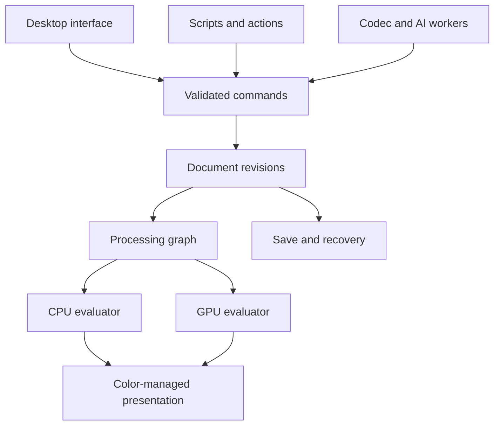

# ArchMage — Full Development Specification

**Document version:** 1.0  
**Prepared:** 11 October 2026  
**Audience:** The coding agent and engineering team responsible for designing, implementing, validating, packaging, and maintaining ArchMage.  
**Status:** Product requirements and proposed engineering baseline. This document is not a claim that any implementation already exists.

### Navigation

| Area | Start here |
| --- | --- |
| Product scope, reference interface, benchmark audit, and stack | [Sections 1–5](#1-development-mandate) |
| Document engine, color, commands, persistence, and recovery | [Sections 6–10](#6-document-model-and-invariants) |
| Editing, selections, layers, retouching, filters, and painting | [Sections 11–16](#11-common-tool-behavior-and-navigation) |
| Typography, photography, AI, animation, and specialist creation | [Sections 17–21](#17-text-vectors-artboards-and-layout) |
| Formats, automation, collaboration, performance, and reliability | [Sections 22–26](#22-file-formats-and-interoperability) |
| Tests, milestones, execution instructions, risks, and completion | [Sections 27–31](#27-verification-strategy-and-acceptance-suites) |
| Contract examples, shortcuts, and source references | [Appendix A onward](#appendix-a-example-contracts) |

## 1. Development mandate

Build **ArchMage**, a professional image editing and creation application deeply informed by Photoshop's workflows and breadth, with strong capabilities drawn from other leading raster, painting, vector, photographic, animation, and image creation tools.

The intended result is a usable production application: an artist must be able to create substantial work, reopen it without damage, exchange it with other applications, and finish client or personal projects without discovering that a visible tool is only a mockup.

The user explicitly requested the name ArchMage, extensive Photoshop-inspired functionality, capabilities from other leading image applications, and a comprehensive development handoff. The technology choices, Linux-first rollout, native format, release stages, and detailed defaults below are proposed implementation decisions. Adopt them unless repository evidence or measured feasibility justifies a documented alternative.

### 1.1 Interpret “all features” as an auditable target

Photoshop is a moving product with platform-specific, beta, cloud-dependent, licensed, and discontinued functionality. No static prose list can establish literal, perpetual equivalence. Therefore:

1. Treat complete coverage of the **frozen, current Photoshop desktop inventory**, including its associated photographic development workflows, as the principal parity target.
2. Inventory relevant Photoshop web, tablet, and mobile capabilities too. Bring their useful editing workflows into the desktop product; do not silently assume the desktop documentation covers them.
3. Cover the additional creation domains specified here, using the benchmark products in Section 3.
4. Record every discovered feature and important option in a traceable feature ledger. “Other tools,” “advanced filters,” and “PSD support” are not sufficiently specific entries.
5. Separate equivalent user outcomes from proprietary implementations, brand services, model weights, or undocumented binary interfaces. Implement ArchMage equivalents where possible. Record unavailable external dependencies honestly.
6. Keep deferred and blocked requirements in the full-development backlog. A milestone release does not make them disappear.
7. Never advertise complete Photoshop parity until every in-scope ledger entry passes its agreed acceptance tests. An approximation, rasterized import, or missing cloud service must remain visibly classified.

The feature examples in this document are a starting floor, not an excuse to exclude a relevant capability discovered during the initial audit. Add missing current-baseline behaviors before freezing the release inventory, and assign them explicit owners, dependencies, and acceptance criteria.

An initial release can be valuable before full coverage. Label its capabilities accurately. This specification defines both those intermediate deliveries and the larger completion target.

### 1.2 Non-negotiable engineering outcomes

- Editing remains responsive while decoding, saving, rendering, exporting, downloading models, or running inference.
- Raster, vector, text, masks, adjustments, linked objects, and animation retain their native editability in ArchMage files.
- Ordinary editing, saving, printing, and exporting work offline without an account.
- Destructive operations are undoable; nondestructive alternatives are the default when practical.
- Document precision, color interpretation, alpha, and metadata are never silently changed.
- Unsupported external-file features produce a specific compatibility report rather than an apparently successful but lossy operation.
- Large documents use bounded caches and storage-backed tiles, not one enormous image allocation per layer.
- Crashes, GPU failures, disk exhaustion, and interrupted saves cannot silently replace a good document with a broken one.
- Menus, shortcuts, scripts, actions, and optional AI-assisted commands use the same validated document operations.
- Core application behavior must be testable without launching the desktop interface.
- Features are complete only when implementation, persistence, undo, user interaction, tests, documentation, and platform behavior agree.

### 1.3 Product boundaries

ArchMage is primarily an image and visual creation studio. Include photography, illustration, graphic design, page composition, comics, pixel art, 2D animation, compositing, and texture creation. Include practical video-layer editing and 3D reference/texture workflows as specified later.

A general CAD system, full sculpting package, digital audio workstation, or feature-film nonlinear editor is not the product definition. Such systems can interoperate through documented formats and extensions. This boundary must not be used to exclude actual Photoshop functionality or the explicitly required image-creation domains.

Current functionality and legacy functionality require separate inventory columns. Adobe documents removal of legacy Photoshop 3D features in July 2024; do not accidentally treat an old manual as the current desktop baseline. ArchMage's own 3D reference and texture requirements remain valid independently. [S04]

## 2. Reference image, interface, and identity

### 2.1 What the supplied reference establishes

The supplied screenshot shows a Photoshop-style desktop workspace: a narrow tool strip on the left, a tool-options row across the top, a document tab, a large central image canvas, color controls above a layers panel on the right, and a small contextual action bar near the artwork.

Use this **information hierarchy and familiar interaction model** as the visual starting point. The screenshot's photographic content and orange annotation-like marks are not application assets or requirements. The coding agent can implement this document without receiving the screenshot again.

### 2.2 Initial workspace layout

At a logical 1440 × 900 desktop size, target the following starting layout; allow resizing and saved arrangements rather than hardcoding the geometry:

| Region | Initial behavior |
| --- | --- |
| Menu bar | File, Edit, Image, Layer, Select, Filter, View, Window, Help; workspace-specific menus appear consistently |
| Options row | Roughly 36 logical pixels high; updates for the active tool; contains typed values and relevant toggles |
| Left tool strip | About 44 pixels wide in one-column mode; optional two-column arrangement and tool-group flyouts |
| Document area | Tabs, split views, detachable windows, an unobstructed canvas, and a configurable pasteboard |
| Right dock | Initially about 300 pixels wide; color/swatches above layers/channels/paths; other panels accessible as tabs |
| Bottom area | Compact status information; timeline, jobs, or node graph only when requested |
| Contextual actions | Movable, dismissible, keyboard accessible; adapts to selection/layer state without covering the active stroke |

Provide a real application menu even where a platform integrates it into its system menu bar. Support dual-monitor arrangements, tabbed docks, floating docks, collapsed icon docks, and restoring a workspace after a monitor is disconnected.

### 2.3 Visual system

- Neutral dark and light themes, with a high-contrast option.
- A restrained violet accent as an initial ArchMage identity; user-configurable accent colors.
- Original icons with a coherent stroke weight and clear selected, hovered, disabled, and pressed states.
- Familiar functional labels: Layers, Curves, Brush, Mask, Export. Do not rename common tools into fantasy terminology.
- The name and optional mage/star motif belong in branding, splash artwork, and the application icon, not across every control.
- Compact, comfortable, and touch-friendly density presets.
- Numeric inputs support units, arithmetic, dragging, keyboard adjustment, and explicit reset.
- Every icon-only command has a tooltip, accessible label, discoverable shortcut, and command-palette entry.
- No promotional panels occupy the editing workspace. The home screen supports recent files, recoveries, templates, and tutorials.

Create original artwork and interface assets. Familiar workflow conventions do not require copying another product's icons, product logos, screenshots, or proprietary bundled brushes.

### 2.4 Workspaces

Ship saved workspaces for General Editing, Photography, Painting, Illustration, Layout, Animation, Pixel Art, and Compositing. They are different panel arrangements over one document model. Switching workspace must not convert a document, discard precision, reset tools, or alter its rendering.

Users can save, duplicate, rename, export, import, and reset workspaces and shortcut profiles. Invalid layouts recover to visible windows rather than leaving all controls offscreen.

## 3. Benchmark coverage and traceability

### 3.1 Research baseline

Official documentation was consulted on 11 October 2026. The table identifies reference strengths; it does not claim ArchMage already matches these products. The detailed requirements later in this document are original product decisions, not a reproduction of any one vendor's manual.

This was a public-documentation survey, not hands-on testing of every benchmark application, exhaustive inspection of every setting, or measured validation of the proposed libraries and models. M0 turns this starting specification into a frozen, option-level implementation inventory and validates the technical choices.

| Benchmark | What to study and translate into ArchMage | Evidence |
| --- | --- | --- |
| Photoshop desktop and its other surfaces | Editing workflows, compositing, interaction conventions, automation, modern assisted editing, and collaboration | [S01], [S02], [S03], [S14] |
| Camera Raw and Lightroom-style photographic workflows | Reversible development, local adjustments, RAW handling, and high-volume photographic work | [S05], [S06]; use darktable as an additional open photographic reference |
| Affinity | Coherent movement between pixel editing, vectors, and page composition | [S07] |
| Krita | Artist-focused painting, brush customization, assistants, animation, and resource organization | [S08] |
| GIMP | Extensibility, editable filter workflows, and precision-aware image operations | [S09] |
| darktable | Scene-referred photographic development, image organization, and module-based processing | [S10] |
| Inkscape and Illustrator | Editable vector construction, typography, and standards-oriented interchange | [S11], [S15] |
| Clip Studio Paint | Comic production, line art, drawing references, and animation-oriented interaction | [S12] |
| Procreate | Fluid painting interaction, brush editing, simple animation, and unobtrusive creative controls | [S13] |
| Aseprite | Pixel-accurate editing, indexed artwork, frame workflows, and sprite exports | [S16] |
| Rebelle | Wet/dry media behavior, paper interaction, and pigment-oriented painting | [S17] |
| Photopea | Familiar editing workflows and pragmatic PSD-oriented interoperability | [S18] |

During inception, expand this survey where it exposes a real requirement gap: professional RAW grading/tethering, procedural texture tools, natural-media painting, and contemporary local image generation. Do not add competitor names as substitutes for specifying behavior.

### 3.2 Required feature ledger

Create `docs/parity/features.yaml` and a generated human-readable report. One entry represents a testable behavior, not an entire department of features. Split compound requirements from this document into child entries with stable IDs.

Each entry contains:

- Stable ID and parent requirement from this specification.
- User outcome, command/tool entry points, and important options.
- Benchmark product, edition, platform, observed version, source URL, and observation date.
- Scope: current baseline, extended capability, legacy compatibility, or external service.
- Planned milestone and prerequisite IDs.
- Supported document modes, precision, alpha, layer types, and animation behavior.
- Implementation state: `unstarted`, `researching`, `partial`, `implemented`, `verified`, or `blocked`.
- Fidelity: `equivalent`, `approximate`, `raster_fallback`, `preserved_uneditable`, or `unsupported`.
- Persistence version, command ID, test IDs, demonstration fixture, and measured limitations.
- Platform availability and any separately installed codec, model, service, or hardware requirement.

Never collapse fidelity and implementation state into one “supported” checkbox. A verified flattened preview is not equivalent to an editable layer import.

### 3.3 Completion reporting

Report the count of verified behaviors, partial behaviors, blocked dependencies, and unsupported cases by domain. Keep the denominator frozen per release and display newly discovered requirements separately. Report critical failures individually; a percentage cannot offset broken saving or inaccurate color.

Recheck the benchmark before major releases. New upstream features go into a dated next-baseline backlog so the current release has a finishable scope. Only an explicit product-scope decision can remove a mandatory item; an implementation agent must not delete difficult rows to improve coverage.

## 4. End-to-end product journeys

Develop around these workflows, with real assets and reopenable project files:

1. **Photo retouch:** Open a RAW exposure, set development parameters, remove distractions on an independent layer, mask a subject, adjust tones, soft-proof, save the project, and export web and print versions.
2. **Complex composite:** Place several linked images, refine hair/transparency, transform a perspective element, add adjustments and typography, compare layer compositions, then exchange an editable PSD with documented fidelity.
3. **Illustration:** Start a high-resolution canvas, draw with a pressure tablet, use symmetry and perspective aids, paint with dry and wet brushes, manage references and palettes, and export a timelapse and layered project.
4. **Graphic design:** Combine vectors, photographs, and editable international text across artboards; create reusable symbols; export selected assets at several resolutions.
5. **Comic:** Create a multipage project, draw panel frames, ink editable strokes, fill closed regions with small gaps, apply screentones, place speech balloons, and export print pages and a sliced webtoon.
6. **Sprite animation:** Work in indexed color at high zoom, edit cels and linked cels, preview onion skin, tag animation ranges, and export an atlas with exact coordinates and frame metadata.
7. **Assisted editing:** Select an object, choose a local or configured remote operation, inspect a result on a new layer, compare variants, and keep or reject it without damaging the original.
8. **Batch production:** Record a reversible sequence, expose parameters, apply it to a folder, handle per-file failures, export to a separate destination, and produce a machine-readable report.
9. **Recovery:** Interrupt the application during a save and during a long operation; restart, recover the latest durable edit state, and verify that the last completed save still opens.
10. **Review:** Share an explicitly chosen version, receive anchored comments, make revisions, and retain a functional local project if the network becomes unavailable.

Each journey needs keyboard and pointer paths, representative data, failure cases, a help page, and an automated integration test where practical.

## 5. Platform strategy and implementation stack

### 5.1 Platform baseline

Use native desktop delivery. Make Linux, including Arch/CachyOS and Wayland/Hyprland, an initial development and validation target. Maintain Windows and macOS buildability early; full release qualification applies to all three desktop platforms by the completion milestone.

Test Linux on both a rolling distribution and a stable distribution. Do not equate “runs on the developer's Arch installation” with broad Linux support. Validate X11 fallback, multiple compositors, Windows pen APIs, and Apple Silicon separately.

Mobile and browser companion experiences may be separate clients later. Their existence is not a substitute for a dependable desktop application. Keep the engine portable enough to permit those clients without rewriting document semantics.

### 5.2 Proposed stack

| Concern | Baseline decision | Constraint |
| --- | --- | --- |
| Core implementation | C++20, modern ownership, CMake, Ninja, pinned dependency manifest | No GUI objects in document or processing APIs |
| Desktop shell | Qt 6 Widgets, model/view panels, native dialogs where suitable | Use public supported APIs; avoid a private Qt rendering dependency |
| Canvas presentation | A renderer-owned Qt window/surface; Vulkan first on Linux/Windows | Prototype docking, overlays, mixed DPI, input, and accessibility before commitment |
| macOS GPU | Validate Vulkan portability through MoltenVK; use a native Metal adapter if necessary | Preserve shared rendering semantics and maintain CPU reference behavior |
| Raster engine | Custom sparse tile store and typed processing graph | A general UI bitmap class is not the document representation |
| CPU processing | Portable kernels plus measured SIMD specialization | Retain a correctness reference path and bounded concurrency |
| Color | Little CMS for ICC; OpenColorIO for scene/view transforms | Explicit boundaries; never apply both pipelines blindly |
| Image codecs | OpenImageIO and/or vetted format libraries behind adapters | Availability is per pinned build; PSD editing is a separate subsystem |
| RAW decoding | LibRaw adapter, plus ArchMage development pipeline | A RAW decoder is not a complete photographic editor |
| Text | HarfBuzz shaping, FreeType glyph support, ICU text services | Keep logical text and layout independent of display rasterization |
| Native storage | Versioned SQLite document container with compressed immutable blobs | Working recovery storage and published document snapshots are distinct |
| Compression/hash | Zstandard and a stable content hash such as SHA-256 | Store codec/version and verify lengths and checksums |
| AI inference | Separate worker, initially ONNX Runtime for compatible models | Provider support is model- and machine-specific |
| Video/audio | Isolated FFmpeg-based adapter if its selected build is acceptable | Record exact codec and distribution availability |
| Extension scripting | Python in a worker process; versioned RPC and high-level SDK | Scripts do not receive unrestricted core pointers |
| Tests | CTest plus a selected C++ test framework, Qt interaction tests, fuzzing, image comparisons | One reproducible entry point for each test tier |

These are engineering choices, not claims that the libraries solve the entire application. Official documentation supports Qt tablet events and Vulkan surfaces, ICC/OCIO processing, image codecs, RAW decoding, text shaping, and inference-provider integration. [S19]–[S27]

Qt documents limitations for embedding Vulkan windows in widget interfaces. Make popup stacking, dock movement, input focus, canvas overlays, and HDR presentation explicit inception experiments. If that route fails, replace the presentation adapter while keeping the core and document contracts. [S20]

Pin exact dependency versions and compiler toolchains after the inception build. Do not interpret a rolling documentation URL or this document's date as permission to depend on unreleased APIs.

### 5.3 Dependency and licensing record

Create a dependency manifest with source, pinned version, checksum, build options, license, redistribution obligations, maintenance status, and affected features. Include codecs, fonts, brushes, test artwork, model weights, and optional services.

Use compatible implementations and properly licensed assets. Do not assume public source code, downloadable weights, or an installed competitor grants redistribution rights. Decide the application's distribution/license model before adopting dependencies that would constrain it. Routine development can continue using verified compatible components while that commercial choice remains open.

### 5.4 Architecture boundaries



The arrows indicate responsibility and data flow, not permission for a worker to mutate the document directly. Worker results are validated and committed through commands.

### 5.5 Repository layout

| Path | Responsibility |
| --- | --- |
| `apps/archmage/` | Desktop executable, startup, sessions, workspace composition |
| `apps/archmage-cli/` | Headless render, conversion, validation, batch execution |
| `core/document/` | Document graph, revisions, resource references, invariants |
| `core/commands/` | Operations, validation, transactions, undo descriptions |
| `core/tiles/` | Sparse tile storage, sharing, cache, storage-backed eviction |
| `core/render/` | Evaluation graph, scheduler, CPU kernels, GPU backend contracts |
| `core/color/` | Profiles, conversions, view transforms, proofing |
| `core/brush/` | Input processing, brush engines, stroke replay and deltas |
| `core/vector/`, `core/text/` | Geometry, shaping, layout, editable object content |
| `core/timeline/` | Rational time, cels, keyframes, media references |
| `io/native/`, `io/formats/`, `io/psd/` | Persistence and interchange |
| `services/` | Codec, AI, script, media, and optional collaboration workers |
| `ui/` | Tools, panels, canvas interaction, accessibility, themes |
| `sdk/` | Extension schemas, bindings, examples, compatibility contracts |
| `resources/` | Original icons, presets, translations, templates |
| `tests/`, `benchmarks/`, `fuzz/` | Validation assets and executables |
| `docs/`, `packaging/`, `cmake/` | Decisions, parity ledger, build and distribution |

Honor an existing repository's conventions if development begins in one. Inspect its instructions, build, tests, and current implementation before imposing this layout.

## 6. Document model and invariants

### 6.1 Authoritative document structure

The document model, not the UI tree or a flattened canvas texture, is authoritative. Use stable identifiers for documents, objects, layers, masks, effects, resources, frames, commands, and revisions.

| Entity | Required information |
| --- | --- |
| Document | Schema version, identity, revision, dimensions, resolution, units, color policy, boards/pages, root objects, timeline, metadata |
| Board/page | Independent bounds, origin, trim/bleed/safe regions, guides, background, export settings, object membership |
| Layer/object | Identity, type, name, parent/order, visibility, locks, opacity/fill, blend settings, transform, bounds, masks, effects, content reference |
| Raster content | Sparse tile map, channel definitions, sample representation, storage profile, image origin, version |
| Vector content | Editable paths, nodes, fill/stroke attributes, live operations, shape parameters, instances |
| Text content | Unicode text, paragraph structure, style runs, font references, layout constraints, variation settings |
| Mask | Raster/vector/parametric source, coordinate space, transform linkage, density, feather, inversion, combination operation |
| Embedded object | Nested document or original asset, shared source identity, instance transform, source revision, rendered cache |
| Linked object | URI/path, resolution policy, content fingerprint, expected version, optional embedded last-known-good copy |
| Adjustment/effect | Type and implementation version, typed parameters, input references, mask, color/precision requirements |
| Animation track | Target object/property, rational times, interpolation, cel references, exposure ranges, keyframes |
| Resource | Content hash, MIME/type, codec, dimensions, provenance, license metadata where relevant |
| Revision | Root-state reference, parent revision, transaction metadata, required resources, durability state |

Separate a layer's content identity from its placement in the document. A single source may have multiple independent instances. Duplicating an instance and duplicating its underlying source must be different commands.

### 6.2 Fundamental invariants

- No containment cycles, effect dependency cycles, or recursive linked-document loops.
- Every reference resolves or is an explicit missing-resource placeholder with a stored fallback and diagnostic.
- Object order, hierarchy, and rendering order are deterministic.
- Commands validate locked content, selected targets, edit permissions, and compatible document modes.
- Application panels observe immutable revisions; painting previews use a separately managed in-progress transaction.
- Selection, active layer, and view state are distinct concepts. Undo restores the relevant editing context without corrupting the document.
- A layer's off-canvas content survives nondestructive crop and canvas-size changes.
- Cross-document paste and placement define profile conversion, scale, resolution, resource copying, and naming behavior.
- Unknown schema content is not discarded by opening and saving a file.
- Document identity survives a normal save; Save As creates a new file identity policy explicitly documented for collaboration and links.

### 6.3 Coordinates and dimensions

Use signed 64-bit integer coordinates for tile addressing and image extents, checked arithmetic for allocation sizes, and double precision for document-space geometry. Use local origins for GPU operations to avoid loss of precision far from zero.

Specify mappings among device coordinates, logical UI coordinates, view coordinates, document coordinates, artboard coordinates, layer-local coordinates, and mask coordinates. Centralize these transformations. Tools must not each invent their own zoom or DPI correction.

Use half-open pixel rectangles, a documented pixel-center convention, and consistent edge rounding. Negative layer positions are valid. Define hit-testing, antialiasing, brush coverage, and snapping against those conventions.

An initial large-document design target is 300,000 pixels per axis, but actual permitted operations must be checked against resource estimates and validated limits. Sparse dimensions are not a promise that every possible dense image fits in memory. Publish tested limits for each codec and operation.

### 6.4 Extension-ready types without speculative complexity

Include time, arbitrary channels, nested content, capability flags, and schema migration hooks in the foundation. Implement later domains incrementally. Do not implement a pretend animation engine merely to populate a type declaration, and do not hardwire all content to a single RGBA bitmap that later domains must replace.

## 7. Pixel storage, compositing, and evaluation

### 7.1 Sparse tiled storage

Start with a benchmarkable 128 × 128 tile configuration; record the selected size in the format rather than assuming it forever. A four-channel 32-bit-float tile at that size occupies 256 KiB before compression. Large brush radii and convolution halos are processing concerns, not reasons to allocate the entire document.

Required behavior:

- Allocate tiles lazily; represent empty and uniform tiles compactly.
- Copy-on-write shared tiles across revisions, duplicates, cels, and embedded assets.
- Track dirty regions, content versions, and mip levels.
- Distinguish authoritative source pixels, reusable intermediate results, GPU residency, and disposable thumbnails.
- Evict disposable caches before dirty data or required history.
- Persist or safely spool authoritative dirty tiles before reclaiming them.
- Enforce separate RAM, VRAM, scratch-space, and history budgets under one resource coordinator.
- Support channel-planar or interleaved layouts behind a stable tile interface; select based on measured use cases.
- Support missing channels and non-RGBA content explicitly, including masks, indexed images, CMYK, spots, depth, and material channels.
- Keep a minimum pool of memory available for cancellation, errors, saving state, and recovery UI.

### 7.2 Processing graph

Compile the user-visible layer/object tree into an evaluation graph. Each node declares:

- Stable type and algorithm version.
- Inputs and outputs, color interpretation, alpha convention, precision, and channel requirements.
- Bounds and required input region for any requested output tile.
- Halo/border behavior and whether the operation needs a global analysis pass.
- Parameter hash, source revision, time, random seed, and quality mode.
- CPU/GPU availability, scratch estimate, cancellation checkpoints, and cacheability.

Cache keys include all rendering inputs, including profiles, blend policy, embedded-source revisions, mask versions, frame time, and algorithm version. UI visibility changes and linked-object updates must invalidate the correct descendants without flushing everything unnecessarily.

Classify operations as local, bounded-neighborhood, global reduction, multiscale, temporal, or model-based. A histogram or global tone mapping operation cannot pretend it only depends on its requested tile. A blur must request surrounding pixels; a transform must map the output region into source space with a sufficient interpolation margin.

### 7.3 Interactive versus final evaluation

Render visible regions first. Use mipmaps, approximate previews, and reduced-quality heavy effects while dragging when needed. Label previews where their appearance materially differs. After interaction, converge to final quality asynchronously.

Exports and saved full-quality composites use the authoritative graph at the requested output dimensions and quality. Never export a viewport screenshot or a downscaled preview accidentally. Cached proxy output is usable only when its quality key exactly matches the request.

A user cancellation stops scheduling new work and prevents stale results from committing. It must not free memory still in use by GPU commands; retire resources after the appropriate fences complete.

### 7.4 Alpha and blending contracts

Store original straight/unassociated samples where required to preserve import fidelity and hidden RGB under zero alpha. Use explicit premultiplied representations for compositing and interpolation where mathematically appropriate. Never confuse coverage, layer opacity, paint opacity, fill opacity, and intrinsic alpha.

For ordinary source-over premultiplied composition, define and test:

`Aout = As + Ad × (1 − As)`  
`Cout = Cs + Cd × (1 − As)`

Here `Cs` and `Cd` are already premultiplied colors. Other blend modes require their own correctly derived color/alpha equations and reference fixtures; changing only the RGB combine function is insufficient.

Define behavior at alpha zero, near-zero alpha, negative floating samples, infinities, and NaNs. Retain original source bytes for faithful unchanged round trips even where render intermediates cannot preserve invisible color.

Provide an explicit document blend policy for physically oriented linear-light work and compatibility-oriented encoded-space work. Imported files select an appropriate policy or produce a compatibility notice. Do not globally linearize every Photoshop-style blend and claim its appearance is unchanged.

### 7.5 GPU contract

- CPU reference implementations define correctness for core operations.
- GPU and CPU paths share parameter semantics and test fixtures.
- Shader and kernel compilation occurs outside interaction-critical paths; caches include driver/device/compiler versions.
- Handle device loss by canceling unsafe work, preserving document state, and restarting with CPU presentation when possible.
- Avoid synchronous full-canvas GPU readbacks for every pointer event or thumbnail refresh.
- Bound VRAM allocations and tile residency; coordinate inference memory with the renderer.
- Validate before submitting work. Untrusted files or plugins must not directly supply arbitrary host GPU command streams.
- Use explicit tolerances for float comparisons; require exact results for integer operations that promise exactness.

## 8. Color science, precision, and channels

### 8.1 Required modes

Support RGB, grayscale, CMYK, Lab, indexed color, bitmap, and multichannel documents, with spot channels and named alpha channels. Implement 8- and 16-bit integer and 16-/32-bit float where meaningful, documenting supported combinations per operation.

The existence of a CMYK export option does not establish editable CMYK-document support. Likewise, a palette preview does not establish indexed editing if paint operations silently convert the document to RGB.

Maintain a mode/precision capability table generated from the operation registry. If an operation requires conversion, offer an explicit reversible conversion or a nested working object; otherwise disable it with a reason. Do not silently quantize, flatten, clamp HDR values, or drop channels.

### 8.2 ICC workflows

Implement embedded profile detection, profile assignment, profile conversion, working-space preferences, rendering intents, black-point compensation, profile mismatch handling, and missing-profile policies.

**Assign** changes interpretation without changing the stored sample values. **Convert** changes samples to preserve appearance under the chosen conversion. These commands must remain distinct in the interface, API, and tests.

Provide sRGB-oriented defaults for general artwork, appropriate wide-gamut choices, custom profile loading, display-profile monitoring, and per-monitor presentation. Moving a window between monitors must update presentation without changing document pixels.

### 8.3 OCIO and HDR workflows

Support scene-referred floating-point data, configurable working spaces, selectable displays/views/looks, exposure inspection, gamut warnings, and OpenEXR workflows. Preserve values outside the nominal display range. OCIO distinguishes reference spaces and display/view transforms; ArchMage must retain that distinction. [S22]

Use a named pipeline, for example: source decode → working representation → operations → optional view transform → display encoding. ICC and OCIO paths can interoperate only through declared conversions. Avoid double applying a display transform or baking a viewing LUT into document pixels without an explicit command.

HDR display output is a separate platform capability from HDR document storage. Negotiate output format, transfer function, reference white, maximum luminance, and OS/compositor support. Offer correctly tone-mapped SDR viewing when HDR presentation is unavailable. Never label an SDR swapchain “HDR” because the document uses float samples.

### 8.4 Print and specialty color

Require soft proofing, paper/black simulation, gamut warning, separation previews, ink coverage inspection, overprint-aware export where supported, custom spot channels, and documented duotone/tritone/quadtone behavior.

Ship only color libraries that may be distributed with the application. User-installed libraries need provenance and version information. Device and printer profiles are selectable resources; no universal “CMYK profile” can be assumed correct for every printer.

Scientific channels, masks, normal maps, and height maps are data channels. Do not run them through an artistic color transform by default.

### 8.5 Color acceptance fixtures

Test tagged and untagged images, profile assignment versus conversion, transparent saturated edges, neutral ramps, wide-gamut patches, CMYK separations, Lab conversion, indexed palette identity, negative and above-one float values, EXR alpha, and windows spanning monitors.

Use numeric comparisons in the appropriate space and calibrated visual checks. An operating-system screenshot alone cannot prove color accuracy or HDR correctness.

## 9. Commands, history, and concurrent work

### 9.1 Command system

Each mutation has a stable command ID, schema-versioned parameters, explicit target IDs, preconditions, resource estimate, transaction policy, human-readable label, and undo representation.

The UI, action recorder, script API, and optional assistant dispatch these commands. A panel must not bypass locks or history by modifying engine structures directly.

Support grouped transactions for strokes, multi-object transforms, imports, and compound workflows. Interactive previews are provisional. Escape or Cancel restores the pre-interaction revision; confirmation creates one meaningful history item unless the tool explicitly documents another model.

### 9.2 Undo and history

- Undo/redo is exact for committed raster edits: retain changed tile versions or deltas, not merely a recipe that might render differently later.
- Store semantic parameters as additional provenance for editable operations.
- Coalesce continuous slider movement and pointer drags into sensible history entries.
- Record seeds and algorithm versions for stochastic tools.
- Support named snapshots, history search, recoverable branching after undo, and optional persisted history.
- Separate the clean save point from the history cursor; undoing back to the saved revision clears the modified marker correctly.
- Retain required resources while any current state, history branch, saved snapshot, or active job references them.
- Report before permanently pruning durable history to meet a user-selected budget. Ordinary cache eviction needs no interruption.

Persisting all history is optional; preserving the current editable state is mandatory. Save previews and undo checkpoints must not cause unbounded document growth.

### 9.3 Job scheduling and stale results

Use a document mutation executor with serialized commits, plus worker pools for processing. Jobs evaluate an immutable source revision. Long-running work must carry a cancellation token, job identity, source fingerprint, and target identities.

When results finish:

1. Verify the target still exists and the relevant source state is compatible.
2. Commit automatically only when the documented preconditions remain valid.
3. Otherwise keep the result as a recoverable candidate, offer insertion as a new object, or let the user re-run it.
4. Never overwrite intervening user edits or attach a result to whichever layer happens to be selected now.

Closing a document, undoing an operation, changing frames, deleting a target, and replacing a linked source all exercise this contract.

## 10. Native format, saving, and recovery

### 10.1 Native file

Use `.archmage` as the proposed native extension and `application/x-archmage` as a provisional MIME identifier pending registration and platform packaging decisions. The file is a versioned SQLite container, not a flattened image with a custom suffix.

Store a manifest, typed object data, immutable compressed tile/resource blobs, resource references, profiles, previews, optional history, and migration metadata. Include a small application identifier and explicit major/minor schema and capability requirements.

Illustrative logical tables:

| Table | Purpose |
| --- | --- |
| `manifest` | Document identity, schema, current revision, capabilities, color policy |
| `objects` | Typed serialized object payloads with stable IDs |
| `relations` | Parent/order and typed references with validated ownership |
| `resources` | Content-addressed blobs and decoding metadata |
| `tile_maps` | Raster version, tile coordinate, channel plane, resource hash |
| `revisions` | Revision roots, transaction labels, referenced resources |
| `assets` | Embedded/linked sources and dependency metadata |
| `previews` | Thumbnail and full-composite caches with revision/quality tags |

This is a logical model, not a finished SQL schema. Design and benchmark indices, migration steps, blob size limits, and compaction before freezing schema version 1.

### 10.2 Working files versus saved files

Use a local application-controlled recovery workspace for active editing. It may use SQLite WAL. A user-facing saved file must be a complete, closed, self-contained snapshot that does not depend on a stray `-wal` or `-shm` file.

SQLite's WAL documentation describes its sidecar and filesystem constraints; do not copy only the main database while an active WAL contains required transactions, and do not use an active WAL workspace on a network filesystem. [S28]

### 10.3 Save transaction

1. Capture an immutable committed document revision.
2. Materialize all required content into a temporary destination beside the final file, using SQLite's supported snapshot/backup mechanisms or a validated equivalent.
3. Finalize database transactions and any journal/checkpoint state needed for a standalone file; close the destination database.
4. Validate required references, manifest, and integrity at the level appropriate to the save path.
5. Flush file data, perform an atomic replace where the platform/filesystem supports it, and apply the required directory/metadata durability steps.
6. Mark that exact revision saved only after success. Edits made during saving remain modified.
7. Retain the previous good file or configured backup until replacement is complete.

Handle destination permissions, low space, file locks, antivirus interference, removable drives, network shares, and cloud-sync conflicts. If the filesystem cannot provide the promised atomicity, use a documented fallback that retains a recoverable previous version and reports the limitation. SQLite transactions do not automatically solve every surrounding filesystem operation. [S29]

### 10.4 Recovery

- Journal recoverable document edits on a short cadence; target a two-second interval under normal local-disk conditions and expose actual durability status internally.
- Guarantee recovery of the last acknowledged durable revision. Do not claim unflushed edits survived a power failure.
- Recover unsaved documents as well as saved files.
- Discover recoveries by document/session identity, not by fragile filename matching.
- Present thumbnail, timestamp, path, and recovered revision; never overwrite the user's original automatically.
- Test process termination during tile writes, transaction commit, backup, checkpoint, rename, and compaction.
- Keep recovery files until a replacement save or explicit discard completes.

### 10.5 Compatibility and migration

Migrate through explicit versioned steps with fixtures from every released schema. Back up before destructive migration. Unsupported newer required capabilities open read-only with their available composite and an explanation.

Preserve unknown optional object payloads and their dependencies when safe. If an edit would invalidate an opaque feature, require an explicit flatten/remove decision or block that edit. Byte-preserving unknown data without understanding its references is not a blanket guarantee of correctness.

Provide `archmage-cli validate` and a recovery/inspection utility that can list objects, verify hashes, extract previews, and salvage unaffected content without executing scripts or contacting remote resources.

## 11. Common tool behavior and navigation

Every editing tool participates in a common lifecycle: activate, configure, begin, preview, commit, cancel, suspend, resume, and deactivate. Define pointer capture, modifier changes, focus loss, Escape, Enter, device removal, and document switching for that lifecycle.

| ID | Required behavior |
| --- | --- |
| NAV-01 | Smooth zoom, fit, fill, actual pixels, zoom-to-selection, scrub zoom, animated navigation with reduced-motion support |
| NAV-02 | Pan, canvas rotation, temporary mirror view, navigator thumbnail, independent views of one document |
| NAV-03 | Rulers, unit switching, guides, guide layouts, grids, perspective grids, smart guides, configurable snapping |
| NAV-04 | Pixel grid, transparency grid, configurable pasteboard, gamut/selection/mask overlays, hide extras |
| NAV-05 | Eyedropper with configurable sample radius, source layers, color space, and channel readout; persistent sample points |
| NAV-06 | Measurements, angles, custom scale calibration, area/count annotations, exportable measurement log |
| NAV-07 | Searchable command palette, tool search, contextual help, shortcut conflict editor, repeat-last-operation |
| NAV-08 | Drag-and-drop open/place behavior, rich clipboard, cross-document copying, duplicate view, detachable tabs |

Mouse-wheel and touchpad behavior must distinguish navigation from numeric-control changes. Do not let a wheel event unexpectedly change brush opacity while the user is navigating the canvas.

Ruler measurements use document units and resolution; preview zoom never changes their meaning. View mirroring must not flip the actual exported image unless the user invokes a separate document command.

## 12. Selections, channels, and masks

### 12.1 Selection tools

| ID | Required behavior |
| --- | --- |
| SEL-01 | Rectangular and elliptical marquee, single-row/column selection, fixed size/aspect, antialiasing, feather |
| SEL-02 | Freehand, polygonal, and edge-following magnetic lasso; adjustable edge sensitivity and point editing |
| SEL-03 | Color tolerance/wand selection with contiguous and global modes, sample-source control, transparency handling |
| SEL-04 | Brush-based selection, quick region growth, flood selection with gap closing and edge sensitivity |
| SEL-05 | Color range, luminance, channel, focus/depth, object, subject, sky, and people/part selection as available modules |
| SEL-06 | Add, subtract, intersect, replace, invert, select all, deselect, reselect, grow, shrink, border, smooth, feather |
| SEL-07 | Move/transform the selection boundary independently of selected pixels; save/load named selections |
| SEL-08 | Select from layer alpha, path, mask, channel, text, vector shape, or object bounds |
| SEL-09 | Dedicated refinement workspace with edge radius, hair/fur/transparency refinement, decontamination, and preview backgrounds |
| SEL-10 | Convert selection to mask/path/channel, copy/cut/paste inside or outside, selected-area fill and stroke |

Selections are coverage fields, not only binary rectangles or polygon outlines. Preserve fractional coverage through composition and saving. Marching ants are a visualization of coverage, not the actual selection data.

Define selection combination math and test repeated additions/subtractions so feathered boundaries do not unpredictably harden. Applying the same mask twice is not implicitly equivalent to applying it once; avoid accidental duplicate attenuation.

### 12.2 Masks and channels

| ID | Required behavior |
| --- | --- |
| MSK-01 | Raster layer masks, vector masks, group masks, multiple effect masks, and reusable named masks |
| MSK-02 | Independent mask visibility, enable/disable, inversion, density, feather, visualization, and transform linkage |
| MSK-03 | Clipping chains with an explicit base object and predictable ordering through groups |
| MSK-04 | Parametric luminosity/color masks and live combinations of raster, vector, and range masks |
| MSK-05 | Paint, paste, fill, filter, and transform a mask with the same core tools where meaningful |
| MSK-06 | Channel inspection, isolate/composite display, duplicate/split/merge, named alpha and spot channels |
| MSK-07 | Channel calculations and apply-image operations with source document/layer/channel, blend, inversion, scale, and offset |
| MSK-08 | Mask-to-selection and selection-to-mask workflows without unwanted profile conversion |

The layer panel must make the active editing target unmistakable. A brush painting a mask instead of its layer should show both a selected mask thumbnail and an appropriate cursor/toolbar state.

Mask/channel operations must persist, undo, and render consistently at nonzero layer origins and under transforms. Hair refinement must be evaluated against transparent and complex backgrounds, not only white-background examples.

## 13. Layers, embedded objects, and styles

### 13.1 Layer and object management

| ID | Required behavior |
| --- | --- |
| LAY-01 | Raster, vector, text, adjustment, fill, group, embedded/linked object, RAW, video, and generator content types |
| LAY-02 | Create, rename, reorder, duplicate, delete, group, ungroup, multi-select, search, filter, color-label, and collapse |
| LAY-03 | Visibility, solo, opacity, fill opacity, alpha lock, pixel lock, position lock, complete lock, linked movement |
| LAY-04 | Align/distribute by selection, key object, canvas, or board; sensible support for transformed bounds |
| LAY-05 | Merge selected/visible, stamp visible to new layer, flatten, rasterize, trim transparent bounds; all undoable |
| LAY-06 | Layer compositions storing selected visibility, position, and appearance states; compare and batch export |
| LAY-07 | Auto-align and auto-blend stacks, with projections and explicit output layers/masks |
| LAY-08 | Background-layer behavior, frames/placeholders, object isolation, and content replacement |

Display large layer trees through virtualized model/view lists. Do not create thousands of heavy widgets merely to show thumbnails and names.

### 13.2 Blend coverage

Implement Normal, Dissolve, Darken, Multiply, Color Burn, Linear Burn, Darker Color, Lighten, Screen, Color Dodge, Linear Dodge/Add, Lighter Color, Overlay, Soft Light, Hard Light, Vivid Light, Linear Light, Pin Light, Hard Mix, Difference, Exclusion, Subtract, Divide, Hue, Saturation, Color, and Luminosity. Implement group Pass Through separately from isolated-group Normal.

Also cover paint-specific modes such as behind/erase where relevant. Inventory channel-specific and precision-specific restrictions rather than assuming every mode has identical meaning in RGB, CMYK, Lab, and HDR.

Required advanced blending includes channel enablement, luminance/channel blend ranges with split handles, knockout behavior, clipping effects, isolated/pass-through groups, and the distinction between opacity and fill opacity. Match behavior through fixtures, especially nested groups, transparent bases, clipped adjustments, and styles extending beyond masks.

### 13.3 Embedded and linked objects

ArchMage's embedded objects fulfill Smart Object-style workflows while using ArchMage terminology and a documented internal model.

- Embed raster, vector, RAW, or nested ArchMage content.
- Create independent or shared instances deliberately.
- Open nested content in a tab, edit it, and update dependents as one transaction.
- Apply reversible transforms, filters, and masks to the instance.
- Replace content while retaining instance placement and effects.
- Convert linked to embedded and embedded to linked; package dependencies for transfer.
- Detect changed, moved, missing, inaccessible, or cyclic sources.
- Retain a last-known-good render and make missing-link status visible.
- Offer relink-one, relink-folder, and exact-match lookup without scanning unrelated storage unexpectedly.
- Update linked content through an explicit policy; external changes cannot silently rewrite a saved document during export.

A linked source fingerprint is part of a render snapshot. Saving or exporting pins the source revisions used for that result.

### 13.4 Layer styles and appearances

Implement multiple configurable fills/strokes, drop and inner shadows, inner and outer glows, bevel/emboss, contour, satin-like lighting, color/gradient/pattern overlays, and texture. Include global lighting, per-effect blend mode/opacity, spread, choke, distance, size, angle, contour, noise, and scale where applicable.

Support copying/pasting styles, presets, effect reordering where the appearance model permits it, independent masks, effect scaling, and conversion into explicit editable layers. Presets retain identifiers and versions. Render bounds must include effects extending beyond source content.

## 14. Geometry, resizing, and retouching

### 14.1 Transform tools

| ID | Required behavior |
| --- | --- |
| GEO-01 | Move, scale, rotate, skew, distort, perspective, flip, reference point, numeric transform, transform again/duplicate |
| GEO-02 | Free transform on raster/vector/text/masks/groups; unified handles with type-appropriate behavior |
| GEO-03 | Nondestructive crop, straighten, perspective crop, canvas resize, trim, reveal-all, crop presets |
| GEO-04 | Resample with nearest, bilinear, bicubic families, Lanczos, and validated edge/detail-preserving options |
| GEO-05 | Mesh/curve warp, split warp, cylindrical warp, puppet deformation with pins and rigidity |
| GEO-06 | Liquify-style deformation: push, twirl, pinch/bloat, smooth/reconstruct, freeze/thaw, pressure controls |
| GEO-07 | Perspective planes for placement, cloning, and painting; multi-plane adjustment and vanishing-point aids |
| GEO-08 | Content-sensitive scaling and seam carving with protect/remove masks and preview |

Distinguish changing printed resolution from resampling pixel dimensions. Repeated nondestructive transforms sample the original source rather than repeatedly degrading the previous preview. Handle negative scales, singular matrices, out-of-bounds regions, and transforms spanning tile edges.

Liquify stores a versioned deformation field or equivalent editable representation, with reproducible reconstruction. Face-aware controls are a separate model-assisted capability and must not gate ordinary deformation tools.

### 14.2 Retouch tools

| ID | Required behavior |
| --- | --- |
| RET-01 | Clone stamp with aligned/unaligned sampling, several sources, cross-document sources, offset, rotation, scale, mirror, and overlay |
| RET-02 | Healing brush, spot healing, patch repair, red-eye reduction, blemish/dust cleanup |
| RET-03 | Content-aware fill with editable sampling region, exclusions, structural guidance, and independent output |
| RET-04 | Content-aware move/extend and patching, with source/target blending controls |
| RET-05 | Dodge, burn, sponge, blur, sharpen, smudge, color replacement, ordinary/background/magic erasers |
| RET-06 | Reflection/distraction/wire removal and more advanced cleanup through optional image-analysis models |
| RET-07 | Frequency separation workflow with reversible setup and precision-appropriate reconstruction |
| RET-08 | History brush and artistic-history effects using explicit saved source states |

Sampling supports current layer, current-and-below, all visible layers, and user-selected source sets. Define whether adjustment layers participate and avoid feeding a destination's current stroke back into its source accidentally.

Prefer retouching to a new layer. Output masks and intermediate sources must remain editable where feasible. Non-generative healing and filling remain usable when AI models or internet access are unavailable.

## 15. Adjustments, filters, and generators

### 15.1 Adjustment catalog

Implement editable adjustment layers and per-object adjustment nodes for:

- Exposure, brightness/contrast, levels, curves, gamma, shadows/highlights, whites/blacks, tonal range compression.
- White balance, temperature/tint, color balance, hue/saturation, vibrance, selective color, channel mixer, black-and-white conversion.
- Gradient map, invert, threshold, posterize, color lookup/LUT, color replacement, color matching, and palette remapping.
- Texture/clarity, local contrast, dehaze, grain, vignette, split toning/color wheels, and lens corrections.
- Lab and channel-targeted operations where valid; explicit conversion requirements elsewhere.

Curve tools need histogram overlays, channel selection, eyedroppers, point and freehand editing, numerical points, interpolation choices, presets, and predictable clipping behavior. Gradient tools need interpolation-space selection, midpoint/opacity stops, dithering, repeat behavior, and editable geometry.

### 15.2 Filter families

| ID | Family | Minimum requirements |
| --- | --- | --- |
| FIL-01 | Blur | Gaussian, box, surface/edge-preserving, motion, radial/zoom, lens/bokeh, field/iris/tilt-shift, directional/path variants |
| FIL-02 | Sharpen | Unsharp, edge-aware/smart, high-pass, deconvolution where validated, channel/luminance controls |
| FIL-03 | Noise | Add noise, median, despeckle, spatial/chroma denoise, multiscale and optional model-assisted denoise |
| FIL-04 | Distort | Displacement maps, wave/ripple, polar conversion, lens distortions, pinch, spherize, twirl, offset, perspective |
| FIL-05 | Stylize | Edge detection, emboss, pixelation/mosaic, halftone, poster effects, oil-like stylization, outlines |
| FIL-06 | Artistic/texture | Pencil/charcoal/ink-like treatments, paper/canvas/grain, texture mapping, configurable filter combinations |
| FIL-07 | Render | Solid/gradient/pattern fills, clouds/noise, fibers, light effects, procedural texture and shape generators |
| FIL-08 | Utility | Minimum/maximum, morphological operations, custom convolution, channel math, distance fields, normal/height conversion |
| FIL-09 | Photo synthesis | Panorama stitching, HDR merge, focus stacking, exposure fusion, median/mean stacks, alignment and deghosting |
| FIL-10 | Model-assisted effects | Restoration, colorization, depth-based effects, relighting and style/content transformations through versioned modules |

The ledger must decompose the benchmark's individual gallery filters and options. A visually similar generic shader does not close all entries in a filter family.

### 15.3 Standard filter contract

Every filter has live preview, reset, compare/bypass, editable parameters, preset support, mask support, blend/opacity control, cancellation, deterministic handling of borders, and meaningful progress for expensive work.

Store heavy effects nondestructively when possible. The destructive “apply” route is an explicit transaction. Keep selections consistent between preview and apply. Report precision/mode restrictions before computation starts.

Global and multiscale effects need seam-free tiled execution. Tests must place high-contrast features across tile boundaries. Random generators store seeds; gradients and clouds must not change after reopening or exporting at a different zoom.

## 16. Painting and brush systems

### 16.1 Brush engine requirements

| ID | Required behavior |
| --- | --- |
| PNT-01 | Round, shaped, image-tip, textured, dual-tip, spray/scatter, pattern, particle, and procedural brush engines |
| PNT-02 | Size, hardness, spacing, angle, roundness, opacity, flow, buildup, transfer, wetness, pickup, load, and mixing where supported |
| PNT-03 | Pressure, tilt, barrel rotation, velocity, direction, distance, random, and time dynamics with editable response curves |
| PNT-04 | Stabilization, weighted smoothing, lazy-mouse/string, predictive preview, taper, and optional snap assistance |
| PNT-05 | Pencil/pixel-perfect drawing, erasing, alpha lock, selection clipping, painting through masks and clipping groups |
| PNT-06 | Symmetry, radial/kaleidoscope modes, wraparound/tiled painting, perspective and curve assistants |
| PNT-07 | Brush editor with test area, live preview, reset, parameter search, presets, tags, favorites, and recent brushes |
| PNT-08 | Paint mixing, smudge, mixer brushes, dry media, wet watercolor, oils/acrylics, paper texture, and impasto modules |
| PNT-09 | Editable vector inking with pressure width, line cleanup, intersection erasing, and brush-styled paths |
| PNT-10 | Reference board, detached reference view, palette extraction, swatches, harmonies, and canvas sampling |

Define opacity and flow separately and test buildup at stroke overlaps. Tablet samples must retain timestamps and pressure/tilt history; frame-rate-dependent sampling is unacceptable.

Resample brush paths by a documented spatial/time policy. Device events may be coalesced for rendering but cannot be discarded in ways that change the final line. Predictive strokes are previews only until real samples arrive.

### 16.2 Natural-media simulation

Wet media require persistent simulation state: water, pigment, paper interaction, drying, and any thickness/height data used by the selected engine. Specify a stable simulation timestep and deterministic seed policy.

- Let artists wet, dry, blend, lift, smear, and continue painting over partially dry areas.
- Support configurable paper texture, absorbency, grain scale, brush loading, and mixing model.
- Preserve simulation fields in the native format; flattening them into RGB is an explicit bake command.
- Use document simulation time, not elapsed wall-clock time while the application is closed.
- Snapshot simulation state for undo; restoring only visible RGB must not leave hidden wetness from a future state.
- Provide quality tiers, tile halos, and fallback behavior. Large wet brushes cannot monopolize the event loop.
- Describe approximations honestly. A textured opacity brush is not equivalent to a pigment/water simulation.

### 16.3 Painting acceptance

Test continuous curves, fast flicks, dots, pressure ramps, tilt brushes, slow strokes, edge crossing, rotation, mirroring, fractional zoom, and 125–200% UI scaling. Test mouse-only behavior and actual tablets, including a device with an eraser end and one without tilt.

One stroke is one undo transaction. Interrupting a stroke by device loss or focus change follows a documented commit/cancel rule and never leaves a permanently pressed brush.

Brush-import support includes an explicit parameter-mapping report. Unsupported brush-engine settings cannot be accepted silently as if the brush will paint identically.

## 17. Text, vectors, artboards, and layout

### 17.1 Typography

| ID | Required behavior |
| --- | --- |
| TXT-01 | Point text, paragraph frames, linked text frames, text on paths, text inside shapes, editable text warp |
| TXT-02 | Character/paragraph styles, mixed formatting, kerning, tracking, leading, baseline shift, alignment, indents, tabs |
| TXT-03 | OpenType features, ligatures, alternates, variable-font axes, glyph browser, fallback fonts, font search and preview |
| TXT-04 | RTL and bidirectional text, complex scripts, vertical text where supported, Unicode normalization policy, IME composition |
| TXT-05 | Bulleted/numbered lists, language-aware line breaking, hyphenation, overset warnings, spell checking through optional dictionaries |
| TXT-06 | Editable outlines/fills/effects, text-to-path/selection conversion, font replacement, package/export policy |
| TXT-07 | Color fonts/emoji with documented format support, precise caret movement and selection by grapheme cluster |
| TXT-08 | Font identification suggestions and editable dynamic/template text as optional analysis/data features |

Use real shaping and paragraph layout; drawing one Unicode code point at a time is not an acceptable text engine. Store the logical string, style ranges, language, direction, and font selection. Glyph IDs and raster caches are derived and may vary with font versions. [S26]

Missing fonts trigger a substitution report. Preserve original font references and a cached appearance where allowed; make editable substitution explicit. Never bundle a user's font automatically if its distribution permissions are unknown.

Editing text must not trigger global single-letter tool shortcuts. Enter, Escape, Tab, clipboard, undo, selection, and IME confirmation follow text-editing conventions before canvas conventions.

### 17.2 Vector creation

| ID | Required behavior |
| --- | --- |
| VEC-01 | Pen, curvature, pencil/freehand, node editing, corner/smooth/symmetric handles, path split/join/reverse/simplify |
| VEC-02 | Live rectangles, rounded rectangles, ellipses, polygons, stars, lines/arrows, custom shapes, parameter editing |
| VEC-03 | Boolean union/subtract/intersect/exclude/divide, compound paths, fill rules, editable Boolean groups |
| VEC-04 | Solid/gradient/pattern fills, multiple strokes, dashes, caps/joins, arrowheads, variable widths, brush strokes |
| VEC-05 | Expand stroke/appearance, offset paths, clipping, vector masks, blend/interpolation between objects, envelope distortion |
| VEC-06 | Symbols/instances with overrides, shared styles, live repeats, pattern design, grids and distribution |
| VEC-07 | Bitmap tracing with color/threshold controls, corner preservation, noise cleanup, and editable output |
| VEC-08 | Snapping to nodes, intersections, bounds, centers, guides, baseline, and pixels, with visible snap feedback |

Use robust geometry predicates and test self-intersections, near-coincident edges, extremely small segments, reversed winding, and transformed compound paths. Numerical failures must not crash the application or silently replace paths with empty results.

### 17.3 Artboards and page composition

- Multiple artboards/pages with names, independent dimensions, presets, reorder, duplicate, trim, bleed, and safe areas.
- Object placement across boards, board-local rulers/guides, isolation, and per-board export.
- Reusable master/template content, linked frames, image fitting, object styles, and basic table/layout support.
- Data merge for text/images from explicitly selected CSV/JSON datasets, with field validation and missing-resource reporting.
- Symbols and linked artwork can update across pages while preserving supported instance overrides.
- Preflight for missing fonts/links, overset text, low effective image resolution, unsupported print effects, and output color issues.
- Print-ready PDF workflows, contact sheets, proof sheets, and multipage exports.

Page composition extends image production; do not quietly claim complete desktop-publishing parity from artboards alone. Any additional publishing behavior added to the benchmark ledger needs its own implementation and tests.

### 17.4 Comics and illustration aids

Provide editable panel frames and gutters, speech balloons and tails, text-linked balloon resizing, screentones with print-safe controls, line extraction, gap-closing fill, reference layers, perspective/symmetry rulers, storyboard sheets, page numbering, and long-canvas webtoon slicing.

Keep screentones procedural until export when possible. Preview and warn about destructive resampling that changes their dot pattern. Webtoon slices must reconstruct the source without missing or duplicate pixel rows.

## 18. Photography, RAW development, catalog, and print

### 18.1 RAW pipeline

LibRaw is a decoding component; ArchMage remains responsible for the artistic development pipeline, state management, previews, and user experience. [S25]

Use an immutable RAW source plus versioned development parameters. Establish the processing order explicitly, covering black/white levels, bad pixels, demosaic, white balance, camera/input profiles, exposure, highlight handling, lens correction, denoise, tone/color operations, local masks, sharpening, and output transform. Some operations may need sensor-space inputs; a flattened RGB-only pipeline must not prevent those implementations.

| ID | Required behavior |
| --- | --- |
| RAW-01 | RAW/DNG import through verified decoders; orientation, metadata, camera profile, white balance, black/white levels |
| RAW-02 | Multiple validated demosaic/development quality modes, highlight reconstruction, hot-pixel handling |
| RAW-03 | Exposure, contrast, curves, color grading, HSL/channel controls, local contrast, dehaze, texture, grain, vignette |
| RAW-04 | Lens distortion, chromatic aberration, shading/vignetting, perspective/geometry, profile overrides |
| RAW-05 | Luminance/chroma denoise, sharpening with masking, optional model-assisted denoise and super-resolution |
| RAW-06 | Local brush/gradient/range/object/subject/sky masks, Boolean combinations, tracking between compatible variants |
| RAW-07 | Re-editable RAW layers inside composites; source-preserving development and virtual copies |
| RAW-08 | HDR/exposure merge, panorama, focus stack, alignment, deghosting, source exclusion, and provenance |
| RAW-09 | Before/after, snapshots, parameter copy/paste, presets, batch synchronization and export |
| RAW-10 | Camera support reporting and understandable unsupported-file diagnostics |

The output must be assessed with real scenes: skin, foliage, fabric, saturated LEDs, clipped highlights, low light, moiré, and fine repetitive detail. Do not judge RAW quality solely from a synthetic gradient.

Support Bayer and other sensor patterns only where the selected decoder and processing path are verified. Record unsupported camera/compression combinations precisely instead of claiming every extension variant works.

### 18.2 Asset browser and photographic catalog

Provide a folder browser that works without catalog import. Add an optional managed catalog with ratings, labels, keywords, collections, smart collections, duplicate detection, contact sheets, metadata editing, and search.

The catalog stores references, thumbnails, and workflow metadata; source files are never moved, deleted, renamed, or rewritten merely because they were viewed. Managed-copy import is a separate explicit option.

Support sidecar metadata, virtual copies, missing-file relinking, removable volumes, offline previews, batch renaming, export recipes, and catalog backup/repair. Record conflict policy when external metadata changes. Search and tagging remain local unless the user enables a remote service.

Camera tethering, scanner acquisition, watched-folder intake, bracketing workflows, and camera live preview are separate capability modules with a tested device list. Do not infer support from the presence of a USB cable.

### 18.3 Printing and proofing

Implement printer/page selection, print dimensions, position, orientation, scaling, margins, color management ownership, profile/intent selection, soft-proof preview, contact sheets, multipage selection, and print-to-file.

Avoid double color management by clearly choosing whether ArchMage or the printer/OS owns the final conversion. Test at least one practical print workflow per supported OS. Mark simulated proofing as a preview, not a guarantee of a physical printer's calibration.

## 19. AI-assisted and generative image capabilities

### 19.1 Product behavior

ArchMage includes useful assisted editing while remaining a complete manual editor. Model downloads, provider accounts, billing, and network availability are optional dependencies, not prerequisites for opening a local image.

| ID | Required capability |
| --- | --- |
| AI-01 | Subject/object/background/sky segmentation and interactive region refinement |
| AI-02 | Hair/fur/transparency matting with edge-color handling |
| AI-03 | Object removal, inpainting, generative fill, canvas expansion/outpainting |
| AI-04 | Text-to-image, image-to-image, reference-guided generation, regional instructions and variation comparison |
| AI-05 | Denoising, restoration, deblurring, upscaling, colorization, artifact reduction |
| AI-06 | Depth/normal estimation, background substitution, relighting, compositing harmonization |
| AI-07 | Pose/edge/depth/sketch/mask conditioning, strength controls, reusable workflows where supported |
| AI-08 | Natural-language assistance that proposes ordinary ArchMage operations and editable results |
| AI-09 | Local model management and optional configured remote-provider adapters |
| AI-10 | Result provenance, processing-region visualization, variants, cancellation, and cost/resource feedback |

All listed capabilities belong in the delivery backlog. The exact models are implementation selections requiring quality, resource, availability, and licensing evaluation. A placeholder endpoint or a button that opens a website does not implement a capability.

### 19.2 Provider-neutral architecture

Expose a capability-based provider interface rather than a hardcoded vendor or model-name menu. Each provider advertises supported operations, input formats, masks, dimensions, precision, latency estimates, model identifiers, cancellation, and local/remote execution.

Local execution may use ONNX Runtime, a separately packaged native inference service, or a documented external workflow adapter. ONNX Runtime's execution-provider system supports hardware-specific integration, but not every model or provider combination is interchangeable. [S27]

Keep Python/ML dependencies outside the core desktop process. A model crash or unavailable GPU must not terminate the editor. For a local workflow service such as a user-configured node server, treat custom nodes and uploaded graphs as executable extensions, not harmless image metadata.

### 19.3 Input and output contracts

- Capture the chosen source revision, selected layers, region, mask, context margin, color conversion, and requested resolution.
- Show which pixels will be sent to a remote provider and allow a scoped crop rather than uploading an entire project by default.
- Remove unrelated metadata, hidden layers, comments, and file paths from transmitted imagery unless needed and explicitly selected.
- Convert to the provider's supported encoding explicitly; retain original high-precision sources.
- Keep prompts, seeds where available, provider/model version, masks, references, and returned imagery with a result record.
- Insert accepted output as a new layer/object with an editable mask. Preserve original content.
- Keep variants until the user accepts or discards them; make their storage cost manageable.
- Reconcile late results against their source revision using Section 9.3.
- Map provider errors into useful UI states: unavailable, unauthenticated, unsupported input, resource shortage, timeout, quota, or request rejected.

For targeted editing, define an optional **preserve outside selection** contract: composite the original pixels outside the committed mask, regardless of changes present in the provider output. Allow an explicit feather/context transition zone. Do not promise that a generative model itself preserves faces, text, logos, or unselected pixels exactly.

### 19.4 Local hardware strategy

The reference desktop class includes 32 GiB RAM and a 6 GiB discrete GPU. Model inference must negotiate a shared GPU budget, release caches when appropriate, and offer CPU/tiled/offloaded execution where the selected model supports it.

Publish estimated RAM, VRAM, disk, and download sizes before installing a model. If a model cannot fit, explain the requirement and offer an actually supported smaller model or remote route. Do not promise high-resolution generation on 6 GiB merely because tiled raster editing fits.

Downloads must be resumable, checksum-verified, versioned, removable, and separate from the base application. Store model licenses and provenance. Avoid loading unsafe serialized code when a safe weight format exists.

### 19.5 Assisted command execution

An optional assistant can create typed command proposals, explain steps, and operate through a user-authorized scope. It does not get an implicit shell, unrestricted filesystem, or permission to install plugins.

Treat image text, metadata, comments, imported documents, and provider output as content, not application instructions. Validate every requested command and its targets. Group multi-step edits into a previewable transaction with clear undo. Provider secrets belong in the operating system's credential storage, not project files or prompt logs.

Cloud access uses an explicit provider preference and clear session/request controls; avoid repetitive prompts once the user has granted the relevant scope. No document is automatically uploaded just because the user opens the AI panel.

## 20. Animation, motion, and pixel art

### 20.1 Timeline model

Use rational time rather than assuming every frame is exactly an integer number of milliseconds. Separate frame-rate settings, keyframe time, cel exposures, media timebases, and exported frame durations.

| ID | Required behavior |
| --- | --- |
| ANM-01 | Raster/vector layer animation, cels, linked cels, blank/duplicate frames, exposure lengths, tracks and groups |
| ANM-02 | Onion skin with tint/opacity/range controls, playback loop ranges, markers, frame tags, timeline zoom |
| ANM-03 | Keyframed position, scale, rotation, opacity, supported effects/masks, easing, interpolation, curve editor |
| ANM-04 | Audio reference/waveform, scrubbing, timing markers, muted preview, exact export synchronization |
| ANM-05 | Video layers, trimming, in/out points, transforms, adjustment/effect stacks, time remapping where supported |
| ANM-06 | Frame animation export to GIF/APNG/WebP and image sequences; video export through available codecs |
| ANM-07 | Timelapse recording with resolution/privacy/storage controls and interruption recovery |
| ANM-08 | Motion/optical-flow-assisted operations and basic rotoscope/mask tracking as explicit advanced modules |

Editing a shared cel and breaking its link must be distinct. Frame insertion/deletion, ripple behavior, keyframe interpolation, and layer visibility changes need explicit rules and undo tests.

Playback may skip preview frames to maintain timing, but export must render every requested frame deterministically. Media decoding occurs in workers with bounded queues. Audio failure must not prevent still-image editing.

### 20.2 Pixel art and game assets

| ID | Required behavior |
| --- | --- |
| PIX-01 | Exact pixel pencil/eraser, pixel-perfect stroke cleanup, contiguous fill, integer zoom and pixel grid |
| PIX-02 | Indexed documents with stable palette indices, palette locks, remapping, sorting, ramps, cycling, dithering |
| PIX-03 | Pixel-preserving resize/rotation options, nearest-neighbor defaults, explicit antialiasing controls |
| PIX-04 | Tiled painting, tilemap layers, tile flipping/rotation, shared tile edits, tile replacement and palette variants |
| PIX-05 | Sprite-sheet packing, tags, slices, origins/pivots, trimming, padding, extrusion, JSON metadata |
| PIX-06 | Normal, height, roughness, metallic, emissive and opacity texture workflows with channel-aware previews |
| PIX-07 | Multiple scale exports and engine-friendly image/metadata presets without proprietary engine dependence |

Index 0 is not automatically transparent unless the document's palette policy says so. Palette edits and palette-index remaps are different commands. Round-trip a sprite sheet plus metadata back into frames without losing pivot, duration, or trimmed bounds.

Pixel-art output must not acquire color fringes from inappropriate filtering, premultiplication handling, or atlas padding. Test adjacent sprites with saturated colors and transparent borders.

## 21. Procedural composition, textures, 3D references, and science

### 21.1 Procedural workspace

Expose a user-facing node workspace for compositing and procedural image generation. It uses the same typed operation registry as the layer editor but is not allowed to corrupt the authoritative layer graph.

Support image, mask, scalar, vector, color, geometry, and material-channel socket types; parameter animation; reusable node groups; instance overrides; seed controls; presets; graph search; reroute/annotation; bypass; preview; and baking.

Include noise families, gradients, shapes, distance fields, remapping, blending, warping, edge processing, tileable patterns, channel packing, and material-map derivation. Every graph declares its outputs and dimensions. Reject cycles unless a dedicated bounded temporal/simulation node explicitly defines their semantics.

Layer and node views are related representations with explicit conversion boundaries. A complex arbitrary node graph need not masquerade as a simple layer stack. A procedural layer can contain its own graph, while preserving its editable internals.

### 21.2 3D references and texture work

Deliver an image-creation-oriented 3D module with:

- Import of a validated glTF subset and other selected mesh formats through adapters.
- Orbit/pan/zoom camera, perspective/orthographic view, lights, simple materials, and transparent-background rendering into a composition.
- Reusable pose references, articulated figures, hand/head references, and perspective-aligned guides where available.
- UV-aware texture inspection and painting, symmetry, seams, projection painting, and material-channel selection.
- Nondestructive rendered-reference objects whose camera/light state can be reopened.
- Export of texture maps and baked 2D views, with exact color-versus-data channel handling.

Separate editable reference geometry from a rasterized render. Imported models and textures need size, recursion, material, and decoder limits. Do not advertise broad legacy Photoshop 3D file equivalence based on a glTF preview.

### 21.3 Scientific and technical imaging

Cover measurement scales/logs, object counting, image-stack statistics, calibrated rulers, high-bit-depth grayscale, multichannel inspection, and optional FITS/DICOM import with metadata preservation. Add astronomical stacking and calibration as an extended photographic module where the feature ledger requires it.

Document whether values are raw measurements, display-scaled values, or artistic conversions. Preserve acquisition metadata and channel semantics. DICOM support here is an image import/inspection capability, not a claim of validated medical-diagnostic use.

## 22. File formats and interoperability

### 22.1 Support levels

Every format has separate capabilities for open, place, editable import, save/export, metadata, layers, animation, profiles, precision, and round-trip fidelity. A filename-extension list is insufficient.

| Format/domain | Required target behavior |
| --- | --- |
| `.archmage` | Complete native editable fidelity with migrations and recovery |
| PNG, JPEG | Reliable image interchange, explicit alpha/quality/profile/metadata behavior |
| TIFF/BigTIFF | Precision, multiple images, profiles, compression options, selected layer conventions with explicit reporting |
| WebP, AVIF, HEIF/HEIC, JPEG XL | Support according to validated codec builds; distinguish static/animated, HDR, alpha, and metadata support |
| OpenEXR, Radiance HDR | Float data, channels, alpha, data/display windows, multipart/layer handling where implemented |
| PSD/PSB | Dedicated layered importer/exporter with a published feature-level fidelity matrix |
| SVG/SVGZ | Editable supported vectors/text/gradients; safe handling of unsupported constructs and external references |
| PDF | Page selection, rasterized placement plus supported editable import; deliberate export settings and preflight |
| EPS/PS and AI | Safe, explicitly limited adapters; never confuse PDF-compatible content with full proprietary editability |
| ORA and selected painting formats | Layer/pixel exchange and documented richer-feature fallbacks |
| KRA, XCF, Aseprite and other native formats | Investigate versioned adapters; report exact subsets and preserve original files |
| GIF/APNG/animated WebP | Frame timing, disposal/compositing, palette and alpha semantics |
| Camera RAW/DNG | Source-preserving import and editable development; no implied ability to write original camera RAW |
| BMP, TGA, ICO/ICNS and technical formats | Practical image/application-asset workflows, including multiple icon sizes |
| Video/audio | Versioned codec matrix for import, playback, and export |
| LUTs, palettes, brushes, gradients, patterns | Versioned resource adapters with parameter-level mapping reports |

HEIF-family codecs, fonts, video encoders, and specialized formats may have build or distribution constraints. Resolve them in the dependency manifest and expose actual capabilities at runtime. An unavailable optional codec cannot create a dead export menu item.

### 22.2 PSD/PSB subsystem

Study Adobe's public file-format specification and build a corpus of legally obtained fixtures from multiple document versions. OpenImageIO documents limited PSD reading and no PSD writing in its listed implementation; it must not be treated as a complete layered PSD engine. [S23], [S24]

The dedicated subsystem needs:

1. Bounded parsing of headers, sections, channels, resources, layer records, masks, compression, descriptors, and additional tagged data.
2. Separate handling of PSD and PSB length/size conventions.
3. Layer hierarchy, names, visibility, opacity, supported blend modes, raster content, profiles, resolutions, paths, masks, and clipping.
4. Editable mappings for supported text, shapes, adjustments, styles, layer compositions, and embedded/linked content.
5. A composite preview for unsupported features, plus feature-specific fallbacks instead of flattening the entire document unnecessarily.
6. Preservation of original opaque payloads when dependency-safe, with explicit invalidation after relevant edits.
7. Export of a valid flattened compatibility composite in addition to supported editable structure.
8. Round-trip tests both through ArchMage and through a licensed reference application where available.
9. Correct limits, truncation/overflow defense, cancellation, and streaming of large channel data.
10. A user-readable import/export report listing object IDs/names, affected features, fidelity changes, and available remedies.

Create fixture groups for simple raster layers, every blend family, pass-through groups, masks, clipping, transforms, text scripts, vector shapes, style combinations, adjustments, embedded/linked objects, CMYK/Lab, 16-/32-bit, large PSB, animation, and unknown tags.

Exact rendering equivalence may be prevented by proprietary algorithms, unavailable fonts, or undocumented data. Keep those failures visible in the matrix. Never promise universal lossless PSD round trips merely because a file opens.

### 22.3 Resource-format compatibility

Inventory ABR-style brushes, swatches/palettes, gradients, patterns, curves/levels presets, actions, and other commonly exchanged resources. Implement only mappings that are understood and tested.

Imported actions are parsed into validated ArchMage operations where possible. Unknown commands produce an editable migration report; they are not executed as arbitrary code. Legacy binary Photoshop plugins and UXP extensions require distinct compatibility work and are **not** automatically supported by adding a plugin menu.

### 22.4 Export experience

Provide Quick Export and a detailed export workspace. Include format, dimensions, scale, interpolation, alpha handling, quality, palette/dithering, color conversion/profile embedding, metadata policy, animation range, naming, and destination.

Support selected boards, layers, compositions, slices, frames, and batch variants. Preview the actual output encoding where feasible; report estimated size as an estimate until encoded.

Export does not replace the native project or alter its working color mode. Warn specifically when the chosen output will flatten, discard animation, reduce precision, remove spots, or approximate effects. Save As and Export must remain distinguishable.

JPEG export needs an explicit background/matte policy for transparency. Indexed export needs a defined transparent index and quantization policy. Premultiplication and color conversion must not create dark/bright borders.

## 23. Assets, automation, scripting, and extensions

### 23.1 Resource manager

Organize brushes, patterns, gradients, palettes, materials, fonts references, styles, shapes, templates, actions, node groups, and model presets. Support tags, search, previews, favorites, duplication, import/export, versioning, and missing-resource resolution.

Distinguish bundled, user-installed, document-embedded, and remote resources. Documents embed or fingerprint the resources necessary for reproducibility. Deleting a brush preset from the library must not make an existing painting impossible to render.

Install resource packs transactionally with manifest validation, checksum verification, path-traversal protection, dependency reporting, and clean removal. Passive resource packs do not run code.

### 23.2 Actions and batch processing

- Record semantic commands and parameters, not screen coordinates.
- Include editable steps, conditions, loops with bounds, prompts, stop markers, enabled/disabled steps, and parameter overrides.
- Clearly mark non-recordable interactive operations; offer a reproducible parameterization where possible.
- Support batch input selection, collision policy, destination templates, dry-run summaries, cancellation, resumption, and per-file results.
- Preserve source files by default. In-place replacement is an explicit option with recoverable handling.
- Provide data-driven templates and variables for text, visibility, image replacement, and export naming.
- Actions run through normal locks, transactions, feature capabilities, and command validation.

### 23.3 Scripting SDK and CLI

The SDK exposes documents, layers, masks, paths, text, colors, selections, resources, transactions, jobs, and exports through stable schemas. Scripts can request tile regions with explicit memory budgets. Do not copy a gigapixel document through JSON just to run a filter.

Use shared-memory or streaming transport for large pixel payloads with ownership, lifetime, bounds, and cancellation rules. Version the protocol independently of internal C++ layouts.

Provide headless commands for rendering, converting, validating, inspecting, batching, generating previews, and running authorized scripts. Use structured output, defined exit codes, progress streams, and error records. Headless behavior must not wait for an invisible modal dialog.

Initial SDK examples: resize/export a folder, generate contact sheets, build a layered template, apply a parameterized adjustment, export sprite tags, and implement a simple tile filter.

### 23.4 Plugin architecture

Support extension points for import/export codecs, filters/generators, tools, panels, resources, automation, and provider adapters. Version manifests and declare required app/API versions and capabilities.

Default third-party execution is out of process. Permit native in-process modules only as an explicit trusted tier with an explained stability impact. A Python subprocess alone is not a security sandbox; apply operating-system restrictions and brokered filesystem/network access where isolation is promised.

Manage installation, updates, enable/disable, dependencies, conflicts, crashes, safe mode, and rollback. A failed plugin is quarantined for the next startup without preventing access to unrelated documents.

Persist unavailable plugin nodes as opaque editable-state records plus cached appearance when possible. Provide install-compatible-plugin, keep-frozen, or bake-to-pixels options. Do not silently delete a node because an extension is absent.

## 24. Collaboration, portability, and optional services

### 24.1 Local-first document ownership

Every user can create, edit, save, package, and export local work without the collaboration service. Optional sync must synchronize finalized document versions or application-level objects, not raw copies of active SQLite WAL files.

Support portable project packaging with linked assets, resource manifests, profiles, fonts only when permitted, and a preflight report. Allow relative links and relocation without rewriting the artwork.

### 24.2 Review and shared work

Provide optional review links with explicit access mode, anchored comments, revision-specific previews, notifications, resolved/unresolved threads, and version comparison. Shared files and review previews have separate permissions.

If cloud storage is enabled, support conflict detection, offline queues, version history, restore, and transparent quota/error reporting. A failed upload does not make a successful local save appear unsuccessful, or vice versa; expose the two states separately.

Real-time co-editing is an advanced deliverable with a defined consistency model:

- Presence and comments can be collaborative without altering image data.
- Structural commands receive an authoritative order and validated object versions.
- Raster/brush edits initially use explicit layer/object leases or branches, not unexamined last-writer-wins tile replacement.
- Disconnected edits rejoin through conflict-aware branches and visible reconciliation.
- Never assume a text CRDT automatically solves mask, tile, transform, and effect conflicts.
- Shared undo is scoped to the user's valid operations; it cannot erase another participant's later work blindly.

Implement the service as a separately deployable system with authenticated APIs, durable metadata storage, object storage for immutable content, jobs, access-control tests, and operational documentation. A proposed baseline is PostgreSQL plus S3-compatible object storage; keep the desktop service client behind a versioned interface.

Account creation, invitation, publishing, and remote sharing are explicit user actions. Local projects are private until the user chooses otherwise.

## 25. Performance and resource budgets

### 25.1 Reference hardware and measurements

Use these as **proposed acceptance budgets**, not existing benchmark results. Calibrate in milestone M0, publish reproducible test configurations, and justify any changes before release.

| Profile | Purpose |
| --- | --- |
| A: modern 8+ core CPU, 32 GiB RAM, NVMe, 6 GiB discrete GPU, 2560 × 1600 display | Main performance reference; include an RTX 4050-class device |
| B: 4–8 core CPU, 16 GiB RAM, integrated graphics, SSD | Ordinary editing and graceful resource scaling |
| C: 16 GiB RAM, CPU-only rendering | Correctness, headless work, recovery, safe mode |
| D: Apple Silicon system with recorded unified-memory size | macOS performance, tablet/input, color, and GPU portability |

Record OS, compositor, driver, compiler, power mode, thermal conditions, storage, monitor scale, and exact benchmark file hash. Laptop GPU names alone do not define performance.

### 25.2 Initial target budgets

| Operation | Initial target on profile A | Measurement boundary |
| --- | --- | --- |
| Empty-app launch | Warm ≤2 seconds; cold ≤5 seconds | Process start to usable blank workspace, excluding optional model loading |
| Ordinary menu/panel action | p95 ≤50 ms | Input received to visible UI update, with background jobs active |
| Simple brush preview | p95 ≤25 ms CPU/event-to-submission | Pressure stroke on a 4096² RGBA8 canvas; external pen-to-photon measurement is separate |
| Warm pan/zoom | p95 frame ≤16.7 ms | Cached 24 MP, 20-layer composite fitting the stated view; qualify layers/effects |
| Pixel update after basic stroke | p95 ≤50 ms | Commit of dirty region to correct displayed preview |
| Cached small undo | p95 ≤100 ms | One ordinary stroke or parameter edit; not a whole-document conversion |
| Large-tree interaction | p95 ≤100 ms | Selection/scroll in 2,000-layer fixture with bounded thumbnails |
| Cancellation acknowledgement | ≤100 ms UI feedback; ≤1 second at normal worker checkpoints | Does not require unsafe interruption of an in-flight device kernel |
| Idle resource use | Target <1% CPU after background work settles | No unnecessary continuous canvas redraw or animation |

These budgets do not promise that an uncached 20-layer 24 MP stack with expensive blur and inference recomputes at 60 fps. Measure viewport responsiveness, preview convergence, full-quality rendering, and export separately.

### 25.3 Benchmark corpus

Maintain fixtures for a 24 MP retouch, a 100 MP composite, a 16k illustration, a sparse 100k-square canvas, a 2,000-layer document, a multipage mixed-vector project, 1,000 animation frames with shared cels, a large PSB, and a long batch export.

Test brush sizes from one pixel to large soft/wet tips. Test five simultaneous documents and competing AI jobs. Record peak and retained RAM, VRAM, temporary disk use, cache-hit rate, frame-time percentiles, I/O throughput, and recovery cost.

Sparse-canvas tests must verify allocated content size, not just dimensions. Include fully populated stress fixtures sized to each machine's tested limits.

### 25.4 Resource policy

Start with an adjustable editing RAM budget near half of physical memory and a conservative VRAM budget based on currently available memory, leaving room for the OS and other applications. These are caps for managed caches/work, not a promise that total process overhead is zero.

Estimate operation costs before scheduling. Downgrade preview quality, evict safe caches, spill to scratch, or decline an operation gracefully when necessary. Preserve the current document and explain the specific constrained resource.

Scratch storage selection, usage, cleanup, and low-space warnings belong in preferences. Recovery content must not be deleted by ordinary cache cleanup. Distinguish temporary render caches from unsaved user work in both implementation and UI.

## 26. Reliability, security, accessibility, and platform integration

### 26.1 Untrusted input and process boundaries

Image files, profiles, fonts, archives, plugin packs, scripts, models, SVG/PDF content, and remote responses are untrusted inputs. Validate lengths, dimensions, offsets, decompression ratios, nesting, reference counts, and arithmetic before allocating or executing work.

Use isolated decoders for complex/risky formats and resource-limited subprocesses for media, models, and scripts. Disable active content and remote-resource fetching in imported documents by default. Embedded scripts are never automatically executed on open.

Apply filesystem and network access through documented capabilities. Use platform sandbox primitives where promised, local IPC with peer validation, and bounded message sizes. A localhost socket is not automatically private; a same-user pipe/socket or authenticated loopback endpoint is preferable for workers.

Maintain signed update packages, verified manifests, rollback, a dependency vulnerability process, and an SBOM. Build diagnostics can include sensitive paths or image metadata, so provide a reviewable redacted report and opt-in crash upload. Local editing must not require telemetry.

### 26.2 Robust error handling

Use structured domain errors with user-facing explanations and technical diagnostic codes. Distinguish unsupported input, damaged input, canceled operation, resource exhaustion, unavailable provider, permission denial, and internal failure.

Never catch every exception and silently continue with a blank layer. Preserve recoverable state, identify the affected operation, and offer a practical next action. Background failure must not unexpectedly steal focus or repeatedly display modal dialogs.

On startup failure, offer safe mode that disables optional plugins, acceleration, and previous workspace restoration independently. Do not erase preferences or recovery files as the first troubleshooting step.

### 26.3 Accessibility and internationalization

- Full keyboard access to menus, panels, layer tree, dialogs, numeric controls, and timeline controls.
- Accessible names, roles, state, focus order, shortcut announcements, and selected-target descriptions.
- High contrast, scalable UI/text, colorblind-friendly overlays, reduced motion, configurable cursor visibility.
- No essential distinction conveyed only by color, tiny icons, animation, or hover.
- Localizable strings, pluralization, number/date formats, RTL interface testing, and non-ASCII paths.
- IME and complex-script text entry tested independently of UI translation.
- Pen, mouse, touch, trackpad, and keyboard operation without mandatory gesture memorization.
- Selectable drag thresholds and gesture mappings; alternatives for multi-button or modifier-heavy actions.

Provide useful nonvisual access to document structure and numeric operations while recognizing that detailed image creation is visual work. Do not claim canvas accessibility from adding labels to the toolbar alone.

### 26.4 Platform requirements

| Platform | Required validation |
| --- | --- |
| Linux/Wayland | Native Qt Wayland path, Hyprland plus another compositor, tablet protocol support, fractional scaling, clipboard, drag/drop, portals, multiple GPUs |
| Linux/X11 | Correct input mapping, tablet behavior, display profiles, multi-monitor and fallback rendering |
| Windows | Pen backend selection, pressure/tilt where device supports it, high DPI, file associations, crash recovery, color/HDR integration |
| macOS | Apple Silicon, native menus/dialogs, Retina/mixed DPI, pen input, sandbox/bookmark behavior where packaged, color/HDR, signing/notarization |

Global screen color picking and capture require platform-specific permissions or portals. If the compositor cannot provide a feature, explain that actual limitation and offer in-document sampling. Do not depend on private compositor commands for core editing.

Test suspend/resume, GPU switching, display hot-plug, tablet hot-plug, remote desktop, read-only files, slow storage, and monitor-layout changes. All painting remains in document coordinates under those changes.

## 27. Verification strategy and acceptance suites

### 27.1 Test layers

1. **Mathematical tests:** blend equations, alpha association, interpolation, color transforms, masks, geometry, rational time, tile addressing.
2. **Operation tests:** each command's validation, result, cancellation, undo/redo, dirty bounds, and serialization.
3. **Document tests:** nested structures, shared resources, migrations, save/reopen, missing plugins/assets, and multi-document behavior.
4. **Image tests:** CPU/GPU comparisons, reference renders, seam detection, precision error, profiles, and alpha edges.
5. **UI tests:** actual editing workflows, focus, shortcuts, docking, resizing, keyboard access, and target selection.
6. **Interchange tests:** read/write/round-trip by format, feature, precision, and external application version.
7. **Resilience tests:** forced termination, disk full, corrupt inputs, GPU loss, network failure, plugin crashes, and stale jobs.
8. **Performance tests:** percentile latency, throughput, memory, VRAM, scratch, and regression budgets.
9. **Human validation:** artists, photographers, designers, and tablet users complete representative work without developer assistance.

Use focused tests tied to concrete correctness risks. Do not substitute thousands of tests that mirror trivial implementation details for a small number of real document workflows.

### 27.2 Required named acceptance scenarios

| Test ID | Scenario | Pass condition |
| --- | --- | --- |
| AT-001 | Create, paint, save, close, reopen | Pixels, layers, color policy, precision, names, and relevant editability survive |
| AT-002 | Stroke undo/redo at tile boundaries | Exact raster restoration, no seams, no random reseeding |
| AT-003 | Nested group/clipping/style composite | Fixture result matches its specified blend semantics |
| AT-004 | Hair mask over varied backgrounds | Editable mask and edge color remain usable; no default white halo |
| AT-005 | Assign versus convert profile | Assignment leaves samples unchanged; conversion meets defined appearance tolerance |
| AT-006 | HDR source and SDR/HDR viewing | Extended values survive save/export; display transforms are not baked implicitly |
| AT-007 | Editable CMYK plus spots | Channel identities and output separations survive round trip |
| AT-008 | Repeated object transforms | Final render samples original content; cancel restores exact prior state |
| AT-009 | Linked source changes during export | Export uses one pinned source snapshot, with no mixed-revision tiles |
| AT-010 | RAW develop and reopen | Original source remains unchanged; parameters regenerate the validated result |
| AT-011 | Multilingual text | Arabic/Indic/CJK/emoji examples shape, select, edit, save, and export correctly with pinned fonts |
| AT-012 | PSD feature corpus | Each supported feature meets its fidelity class; unsupported features produce exact reports |
| AT-013 | Interrupted saves | Last completed save opens; latest acknowledged durable recovery opens independently |
| AT-014 | Disk exhaustion mid-operation | No damaged original, no fake success state, useful retry/save-elsewhere route |
| AT-015 | GPU device failure | Current document remains recoverable; safe rendering path works where supported |
| AT-016 | Long AI job with intervening edits | Original edits survive; stale result becomes a candidate rather than an overwrite |
| AT-017 | Mixed-DPI tablet stroke | Cursor, pressure path, canvas, and result align across displays and scales |
| AT-018 | Indexed sprite export/import | Palette indices, transparency, frames, durations, pivots, and atlas bounds remain consistent |
| AT-019 | Animation render | Exact requested frame count/time range and documented audio synchronization |
| AT-020 | Wet-media undo and reload | Visible pixels and hidden simulation state restore coherently |
| AT-021 | Missing plugin/resource | Safe load with preserved data/cached result and no silent deletion |
| AT-022 | Batch with corrupt inputs | Good files finish, bad files are reported, originals remain intact, resumption is reliable |
| AT-023 | Two-user edit conflict | Conflicting edits are preserved or rejected clearly; no silent tile overwrite |
| AT-024 | Unknown future document feature | Compatible preview/read-only behavior; no destructive implicit downgrade |
| AT-025 | Accessibility workflow | Keyboard-only user can open, select a layer, adjust, save, and export without a focus trap |
| AT-026 | Multipage vector project | Text, symbols, bleed, linked assets, preflight, and page exports agree |
| AT-027 | Procedural texture | Saved seed/graph reproduces output; tileable boundaries are continuous |
| AT-028 | Malformed/hostile import corpus | Controlled failure within resource budgets, no active content or unexpected network access |
| AT-029 | 3D texture/reference document | Camera/material/UV state reopens; color and data maps export correctly |
| AT-030 | Measurement/scientific channels | Scale, channel values, metadata, and explicit display transforms remain distinct |

### 27.3 Image comparison policy

Use exact byte or sample comparisons for lossless integer operations, stored tiles, and deterministic undo. For floating point, use per-operation absolute/relative tolerances and explicitly chosen color-space error measures. For generated/stochastic outputs, validate structure, provenance, masked regions, resource use, and a curated quality rubric rather than requiring identical provider imagery.

SSIM alone is insufficient for detecting a lost spot channel, wrong profile, a one-pixel offset, or broken typography. Include structural assertions and semantic metadata checks. Goldens are reviewed assets; updating them is not an automatic response to a failing test.

When comparing competitors, use legally available applications and test files. Record versions, profiles, settings, and fonts. If no licensed reference runtime is available, label the result unverified rather than inventing a parity claim.

### 27.4 Continuous integration and release validation

- Compile core and desktop targets on Linux, Windows, and macOS early.
- Run headless core tests on every relevant change; run GPU suites on representative device runners.
- Include address/undefined-behavior sanitizers, targeted thread-sanitizer runs, and fuzzers for complex parsers.
- Test release builds, installation packages, clean-machine startup, and uninstall/update behavior.
- Preserve benchmark histories and make regressions attributable to changes.
- Keep small distributable fixtures in the repository and version larger corpora in a documented artifact store with licensing metadata.
- Do not ship a feature based only on a developer machine screenshot or a successful debug build.

## 28. Delivery roadmap and milestone exit gates

This is a large product program. Do not promise full parity from a single development pass. Implement vertical slices in dependency order and keep the full ledger active. The stages below express scope and evidence gates, not invented calendar estimates.

### M0 — Inception and feasibility

**Deliver:** Repository audit or clean project initialization; toolchain and license manifest; feature ledger; architecture decisions; real canvas/input prototype; memory and format experiments; test corpus plan.

Required experiments:

- Qt docking plus GPU canvas, menus, tool overlays, mixed DPI, and tablet coordinates.
- CPU/GPU tile compositing with alpha, one blur halo, one profile conversion, and measurable brush latency.
- Native snapshot save, reopen, and kill-during-save recovery.
- Representative layered PSD decoding and rendering, with explicit unsupported records.
- A RAW file, a shaped Arabic/Indic text sample, and a basic macOS GPU path.
- Resource estimates on profiles A–D or a clear record of unavailable machines.

**Exit:** The chosen architecture can execute these slices, limitations are recorded, and high-risk decisions have evidence. If a presentation or storage choice fails, change its adapter now. Do not spend this stage polishing a home screen while the core risks remain untested.

### M1 — Trustworthy raster foundation

**Deliver:** Build/packaging skeleton, usable shell, document tabs, tile engine, command registry, basic brush/eraser, layers, simple selections, source-over composition, common image I/O, native save/reopen, undo/redo, autosave recovery, headless validation.

**Exit:** AT-001, AT-002, AT-013, AT-014 and the initial navigation/input checks pass. A user can perform useful simple edits without a crash or lost save. This is an internal alpha, not feature-complete ArchMage.

### M2 — Layered editing and nondestructive structure

**Deliver:** Groups, masks/channels, clipping, blend modes, adjustments, embedded/linked objects, styles, layer compositions, transform/crop fundamentals, basic editable text/shapes, linked-resource handling.

**Exit:** AT-003, AT-008, AT-009, and applicable native round trips pass. Document hierarchy and render graph have real consumers. Every visible operation has functioning undo and persistence.

### M3 — Selection, retouch, and effects depth

**Deliver:** Full manual selection/refinement suite, clone/heal/patch workflows, conventional content-aware processing, advanced transforms/warp/liquify, filter families, channel calculations, brush/source controls, contextual actions.

**Exit:** Retouch and composite journeys can be completed manually. Filter previews match committed outputs; cancel/stale-job behavior is tested. Model-assisted items remain explicitly assigned to M6.

### M4 — Photographic, color, print, and interchange foundation

**Deliver:** RAW development and catalog foundation, advanced color modes/precision, ICC/OCIO boundaries, proofing/printing, photo merges, PSD/PSB feature-level import/export, broad still-image formats, preflight and packaging.

**Exit:** AT-005–AT-007, AT-010, AT-012, and a real print workflow pass for the milestone's declared scope. Compatibility reports distinguish supported and unfinished fidelity. Unsupported PSD entries remain in the final backlog.

### M5 — Painting, vectors, typography, and layout

**Deliver:** Full brush editor and dynamics, assistants, natural media, vector inking and geometry, symbols, international typography, pages/artboards, comic workflows, resource manager, templates/data merge.

**Exit:** Illustration, design, and comic journeys pass; AT-011, AT-017, AT-020, and AT-026 pass. Tablet artists review actual stroke quality and text users verify representative scripts.

### M6 — Advanced compositing, procedural work, and AI

**Deliver:** Procedural workspace, texture generators, local inference worker, provider adapters, segmentation/matting, generative editing, restoration/upscaling, depth/relighting, variation/provenance UI, assisted command proposals.

**Exit:** AT-004, AT-016, AT-027, resource negotiation, and remote-data boundaries pass. Every claimed AI capability has at least one usable configured implementation with documented requirements; unavailable proprietary features remain explicitly blocked.

### M7 — Motion, pixels, and specialist creation

**Deliver:** Frame/cel/keyframe timeline, audio/video layer handling, pixel/indexed/tilemap workflows, sprite export, timelapse, 3D references/UV texture tools, scientific imaging modules and extended photographic stacking.

**Exit:** AT-018, AT-019, AT-029, AT-030 and motion/sprite journeys pass. Frame timing, palette identity, data-channel semantics, and media resource budgets are reliable.

### M8 — Automation, extensions, and collaboration

**Deliver:** Full action recorder/batch tools, versioned SDK/CLI, extension lifecycle and isolation, resource packs, optional review/sync/co-editing services, portable projects, cloud failure recovery.

The command registry, CLI testing hooks, and worker boundaries must already exist before this milestone. M8 completes their user-facing ecosystem; it does not introduce them for the first time.

**Exit:** AT-021–AT-024, automation and review journeys, API compatibility tests, plugin safe-mode tests, and conflict scenarios pass. Offline local editing remains functional with all services disabled.

### M9 — Full baseline closure and production qualification

**Deliver:** Close every remaining mandatory ledger item, complete compatibility breadth, optimize bottlenecks, verify accessibility/localization, qualify all desktop platforms, finalize installers and documentation.

**Exit:** All applicable acceptance suites pass, required fidelity classes are achieved, platform claims match evidence, and unresolved blockers are explicitly reported. If a mandatory baseline capability remains blocked, ship an honestly labeled partial release if appropriate; do not call full development complete.

Package a release candidate with example projects, migration tests, known limitations, dependency notices, reproducible build instructions, and a support/diagnostic workflow. Full parity claims require the separate signed-off ledger review, not merely reaching the end of this roadmap.

## 29. Bootstrap tasks and coding-agent execution protocol

### 29.1 First development iteration

Execute these in order, adapting to any real existing implementation:

1. Read repository instructions, inspect files/build/tests, identify existing work, and record the starting commit or snapshot.
2. Create `docs/implementation-status.md`, `docs/parity/features.yaml`, `docs/architecture/`, and `docs/decisions/`.
3. Freeze the initial benchmark inventory and decompose the requirements into dependency-ordered tasks.
4. Establish a reproducible C++20/Qt/CMake build and a headless test executable.
5. Implement document IDs/revisions, typed raster tiles, a simple CPU compositor, and basic command transactions.
6. Connect one genuine brush stroke to the canvas, history, and tile store.
7. Save and reopen that layered document through the native format.
8. Add forced-termination recovery and malformed-file tests before expanding the tool palette.
9. Add GPU evaluation for the same narrow slice and compare it with the CPU reference.
10. Complete M0 evidence and M1 scope, then proceed through the remaining milestones.

The first reviewable demonstration is: launch → open/create → paint on a second layer → change opacity → undo/redo → save → close → reopen → export. The project file must remain editable.

### 29.2 Working rules

- Implement real vertical slices before broad UI scaffolding. Hide unfinished production controls or label them clearly in development builds.
- Keep each subsystem behind a tested contract; avoid central classes that own UI, files, GPU, history, plugins, and network behavior simultaneously.
- Record architectural changes with rationale, alternatives, consequences, migration implications, and measured evidence.
- Reuse existing correct work. Do not restart a repository just because this specification suggests a different folder name.
- Address failures at their owning layer rather than adding UI exceptions for engine inconsistencies.
- Keep unfinished requirements and limitations visible. Do not change the definition of done to match what was easiest to implement.
- Make reasonable routine decisions and continue. Escalate only a genuinely blocking product choice, unavailable entitlement, or incompatible requirement; finish independent work in the meantime.
- Do not publish builds, create paid provider accounts, purchase assets, or incur remote inference charges without the necessary project authorization.
- Never claim a platform or device was tested if it was unavailable. Provide exact reproduction instructions and mark the gap.

### 29.3 Required progress report per milestone

Report implemented outcomes, changed modules, passing evidence, manual validation, performance changes, migrations, dependency changes, and open risks. Include runnable commands and at least one sample `.archmage` document demonstrating the slice.

Separate “implemented,” “automatically tested,” “manually tested,” and “verified against a benchmark.” Avoid progress reports made entirely of file counts, function counts, or screenshots of menus.

## 30. Risks, decisions, and scope controls

| Risk/decision | Required response | Latest sensible resolution |
| --- | --- | --- |
| Desktop canvas embedding/input problems | Prototype native surface, popup, focus, DPI, and tablet behavior; change presentation adapter if needed | M0 |
| Distribution/license model | Select compatible dependencies and document remaining constraints; do not copy incompatible source/assets | M0 before dependency lock |
| PSD fidelity | Dedicated corpus and staged mappings; retain feature-level reports and reference-app verification | Begin M0, close required scope M9 |
| Color errors | Centralized typed color pipeline, numeric fixtures, device-aware validation | Architecture in M0–M1, breadth M4 |
| Save corruption | Immutable snapshots, durability protocol, fault injection, preserved previous file | M1 before public editing claims |
| Brush latency | Measure real tablet input early; separate preview from final evaluation | M0 and every painting milestone |
| Arbitrary-channel/animation retrofit | Reserve core abstractions and serialization fields early; implement consumers incrementally | M1 architecture |
| Natural-media cost | Persistent simulation model, bounded timestep, measured quality tiers | Prototype before M5 completion |
| Memory/VRAM contention | Shared budget coordinator, spill/eviction policy, inference negotiation | M1 foundation, M6 AI integration |
| Plugin compromise/crashes | Worker isolation, OS capabilities, safe mode, resource budgets | Worker design early, ecosystem M8 |
| Collaboration conflicts | Immutable versions plus leases/branches and explicit reconciliation | Before shared editing claims |
| Unavailable proprietary APIs/models | Equivalent outcome adapter if possible; otherwise record real blocker | At feature selection, never hidden at release |
| Dependency/codec drift | Pin, verify updates, test corpus, publish capability matrix | Every release |
| Scope expansion | Freeze baseline per release, preserve new items in dated backlog | M0 and release planning |

The proposed architecture may change, but behavioral requirements must remain traceable. A simplification is acceptable when it delivers the same tested outcome; a silent downgrade is not.

## 31. Final deliverables and definition of done

Full development requires:

- Source repository, documented builds, dependency lockfiles, CI, and maintained architecture decisions.
- Installable desktop applications for the claimed platforms and a headless CLI.
- Complete native-format specification, migration fixtures, recovery tools, and representative editable projects.
- Verified feature ledger with commands, tests, source baselines, supported modes, and documented fidelity.
- User documentation, shortcuts, tutorials, SDK documentation, plugin examples, and troubleshooting guidance.
- Import/export compatibility matrices and file-level reports users can actually inspect.
- Benchmark corpus, results, hardware details, resource budgets, and known practical limits.
- Localization/accessibility validation, platform input/color validation, and meaningful artist workflow feedback.
- Distribution notices, resource/model provenance, update/rollback design, and optional service deployment documentation.
- No silent data-loss defects, false save success, fake feature controls, or unsupported “complete parity” claims.

A single feature is done only when its **interaction, engine behavior, undo/redo, persistence, compatibility consequences, error handling, accessibility, tests, and documentation** are complete for its declared scope.

A milestone can finish before the entire product. Full development finishes only when the frozen mandatory baseline and specified extended domains have met their acceptance criteria. If mandatory items remain unmet, report them as outstanding; do not label full development complete.

## Appendix A. Example contracts

These examples establish the intended shape of implementation artifacts. They are proposed schemas and command lines to implement, not APIs or executables that already exist.

### A.1 Feature-ledger entry

```yaml
id: PNT-03-pressure-size
parent: PNT-03
title: Pen pressure controls brush diameter
outcome: Artist varies line width continuously during a stroke.
scope: extended_capability
milestone: M5
prerequisites: [input-tablet-events, brush-sampling, raster-transactions]
implementation_state: unstarted
fidelity_target: equivalent
fidelity_verified: null
benchmark:
  product: Krita
  edition: desktop
  observed_version: null
  source_url: https://krita.org/en/features/
  observed_date: 2026-10-11
  evidence: public_documentation_only
planned_capabilities:
  input: normalized_pressure
  response_curve: editable
  fallback: fixed_diameter_for_devices_without_pressure
  undo: one_transaction_per_stroke
  persistence: brush_preset_and_committed_tile_versions
command_id: archmage.paint.stroke
acceptance:
  - A recorded pressure ramp changes diameter according to its response curve.
  - Final pixels do not depend on display refresh rate.
  - Undo and redo restore exact committed pixels.
  - A mouse stroke uses the configured non-pressure diameter.
test_scenarios: [AT-002, AT-017]
platform_results: {}
limitations: []
```

Replace `observed_version: null` with an actually verified version during baseline capture. A source URL alone does not prove a specific installed version was tested.

### A.2 Command envelope

```json
{
  "protocolVersion": 1,
  "commandId": "archmage.layer.setOpacity",
  "parameterVersion": 1,
  "requestId": "request-00042",
  "documentId": "document-example",
  "baseRevision": 104,
  "targetIds": ["layer-foreground"],
  "parameters": {"opacity": 0.65},
  "transaction": {
    "id": "transaction-example",
    "label": "Change layer opacity"
  }
}
```

The service validates numeric range, document identity, target existence, lock state, and revision compatibility. A repeated `requestId` must not apply the same mutation twice. Idempotency scope, retry lifetime, and result retention are part of the protocol.

Commands may return a committed revision, a job reference, a validation error, or a conflict. They never return success before the represented mutation is accepted. A mutation being accepted and a revision being durably saved are separate events.

### A.3 Render request

```json
{
  "documentId": "document-example",
  "revision": 104,
  "outputId": "board-cover",
  "region": {"x": 0, "y": 0, "width": 2048, "height": 2048},
  "time": {"numerator": 0, "denominator": 1},
  "quality": "final",
  "destination": {
    "channelModel": "RGBA",
    "sampleType": "uint8",
    "profileResource": "profile-srgb-example",
    "alphaAssociation": "straight"
  }
}
```

The real schema must distinguish document, source, output, and view transforms; the compact example assumes those are already captured in the referenced revision/output. An export encoder consumes the render result, not the UI framebuffer.

### A.4 Required CLI shape

```bash
archmage-cli inspect artwork.archmage --json
archmage-cli validate artwork.archmage --deep
archmage-cli render artwork.archmage --board cover --output cover.png
archmage-cli batch --recipe recipe.json --inputs inputs.json --report result.json
archmage-cli recover --session session-id --output recovered.archmage
```

Specify collision behavior, output profiles, codec options, secrets handling, resource limits, and noninteractive error behavior in the implemented CLI documentation. A recovery command must not overwrite an original file by default.

## Appendix B. Initial shortcut profile

Provide a familiar default profile plus full remapping. Use Command in place of Control for conventional macOS document commands; preserve platform text-input conventions and expose conflicts rather than blindly replacing every modifier.

| Action | Initial Windows/Linux shortcut |
| --- | --- |
| New / Open / Save / Save As | Ctrl+N / Ctrl+O / Ctrl+S / Ctrl+Shift+S |
| Undo / Redo | Ctrl+Z / Ctrl+Shift+Z |
| Cut / Copy / Paste | Ctrl+X / Ctrl+C / Ctrl+V |
| Free transform | Ctrl+T |
| Select all / Deselect / Reselect | Ctrl+A / Ctrl+D / Ctrl+Shift+D |
| Invert selection | Ctrl+Shift+I |
| Duplicate selection or layer | Ctrl+J, with documented context behavior |
| New layer | Ctrl+Shift+N |
| Move / Marquee / Lasso | V / M / L |
| Selection group / Crop | W / C |
| Brush / Eraser / Retouch group | B / E / J |
| Clone / Gradient or fill | S / G |
| Pen / Text / Shape | P / T / U |
| Eyedropper / Hand / Zoom | I / H / Z |
| Temporary hand tool | Hold Space |
| Decrease / Increase brush size | [ / ] |
| Swap foreground/background / Reset colors | X / D |
| Hide/show panels | Tab |
| Commit / Cancel active interaction | Enter / Escape |
| Command palette | Configurable binding selected after platform conflict checks |

Tool-group cycling and spring-loaded temporary tool behavior are configurable. Single-letter commands do not fire inside text inputs, text layers, IME composition, or a script editor. Display the active shortcut in tooltips and the command palette.

## Appendix C. Official reference register

These references support the benchmark survey and technical constraints. They are not a promise of permanent API availability. Recheck and pin relevant versions during implementation. Public-documentation behavior, proposed ArchMage behavior, and experimentally verified behavior must remain distinct in project records.

| Ref | Primary source | Used for |
| --- | --- | --- |
| S01 | [Photoshop desktop help](https://helpx.adobe.com/photoshop/desktop.html) | Starting index for the Photoshop capability inventory |
| S02 | [Photoshop desktop release notes](https://helpx.adobe.com/photoshop/desktop/whats-new/photoshop-on-desktop-release-notes.html) | Dated feature changes and baseline refresh |
| S03 | [Photoshop features](https://www.adobe.com/products/photoshop/features.html) | Current product capability overview |
| S04 | [Photoshop filter/effect issues and legacy 3D notice](https://helpx.adobe.com/ca/photoshop/kb/filter-effect-issues.html) | Distinguishing removed 3D functionality from current scope |
| S05 | [Camera Raw masking](https://helpx.adobe.com/au/camera-raw/desktop/edit-and-enhance-images/masking-and-local-adjustments/masking.html) | Local photographic adjustment workflows |
| S06 | [Camera Raw image enhancement](https://helpx.adobe.com/camera-raw/desktop/edit-and-enhance-images/sharpening-and-noise/enhance.html) | Denoise/detail/resolution workflow references |
| S07 | [Affinity](https://www.affinity.studio/) | Integrated visual creation benchmark |
| S08 | [Krita features](https://krita.org/en/features/) | Painting, assistants, resources, and animation benchmark |
| S09 | [GIMP 3.0 release notes](https://www.gimp.org/release-notes/gimp-3.0.html) and [GIMP 3.2 release notes](https://www.gimp.org/release-notes/gimp-3.2.html) | Editable filter and image-processing evolution |
| S10 | [darktable features](https://www.darktable.org/about/features/) and [darktable 5.6 manual](https://docs.darktable.org/usermanual/5.6/) | Photographic development/catalog benchmark |
| S11 | [Inkscape and SVG](https://inkscape.org/en/develop/about-svg/) | Vector document and interchange reference |
| S12 | [Clip Studio Paint features](https://www.clipstudio.net/en/functions/) | Comics, references, inking, and animation benchmark |
| S13 | [Procreate Brush Studio](https://help.procreate.com/procreate/handbook/brushes/brush-studio) and [animation handbook](https://help.procreate.com/procreate/handbook/animation) | Artist interaction and brush/animation reference |
| S14 | [Photoshop sharing for feedback](https://helpx.adobe.com/photoshop/using/share-for-feedback.html) | Review workflow benchmark |
| S15 | [Illustrator text in vector artwork](https://helpx.adobe.com/illustrator/desktop/design-with-text/add-manage-text/add-text-to-vector-artwork.html) | Vector typography reference |
| S16 | [Aseprite features](https://www.aseprite.org/features/) | Indexed/pixel/frame/atlas workflow benchmark |
| S17 | [Rebelle](https://www.escapemotions.com/products/rebelle/about) | Natural-media painting benchmark |
| S18 | [Photopea Smart Objects](https://www.photopea.com/learn/smart-objects) and [open/save](https://www.photopea.com/learn/opening-saving) | Embedded-content and interoperability workflow reference |
| S19 | [Qt tablet events](https://doc.qt.io/qt-6/qtabletevent.html) | Tablet input integration, subject to platform validation |
| S20 | [Qt Vulkan window](https://doc.qt.io/qt-6/qvulkanwindow.html) | Canvas presentation integration and embedding limitations |
| S21 | [Little CMS color engine](https://www.littlecms.com/color-engine/) | ICC color engine candidate |
| S22 | [OpenColorIO displays and views](https://opencolorio.readthedocs.io/en/latest/guides/authoring/displays_views.html) | Scene/display/view-transform distinctions |
| S23 | [OpenImageIO format plugins](https://openimageio.readthedocs.io/en/latest/builtinplugins.html) | Codec capabilities, including PSD limitations |
| S24 | [Adobe Photoshop file-format specification](https://www.adobe.com/devnet-apps/photoshop/fileformatashtml/) | PSD/PSB and related resource-format engineering |
| S25 | [LibRaw overview](https://www.libraw.org/about) | RAW decoding component boundary |
| S26 | [HarfBuzz manual](https://harfbuzz.github.io/) | Text shaping component |
| S27 | [ONNX Runtime execution providers](https://onnxruntime.ai/docs/execution-providers/index.html) | Hardware-specific local inference integration |
| S28 | [SQLite write-ahead logging](https://www.sqlite.org/wal.html) | Working database, sidecar, and filesystem constraints |
| S29 | [SQLite atomic commit](https://www.sqlite.org/atomiccommit.html) | Transaction durability and underlying assumptions |

[S01]: https://helpx.adobe.com/photoshop/desktop.html
[S02]: https://helpx.adobe.com/photoshop/desktop/whats-new/photoshop-on-desktop-release-notes.html
[S03]: https://www.adobe.com/products/photoshop/features.html
[S04]: https://helpx.adobe.com/ca/photoshop/kb/filter-effect-issues.html
[S05]: https://helpx.adobe.com/au/camera-raw/desktop/edit-and-enhance-images/masking-and-local-adjustments/masking.html
[S06]: https://helpx.adobe.com/camera-raw/desktop/edit-and-enhance-images/sharpening-and-noise/enhance.html
[S07]: https://www.affinity.studio/
[S08]: https://krita.org/en/features/
[S09]: https://www.gimp.org/release-notes/gimp-3.0.html
[S10]: https://www.darktable.org/about/features/
[S11]: https://inkscape.org/en/develop/about-svg/
[S12]: https://www.clipstudio.net/en/functions/
[S13]: https://help.procreate.com/procreate/handbook/brushes/brush-studio
[S14]: https://helpx.adobe.com/photoshop/using/share-for-feedback.html
[S15]: https://helpx.adobe.com/illustrator/desktop/design-with-text/add-manage-text/add-text-to-vector-artwork.html
[S16]: https://www.aseprite.org/features/
[S17]: https://www.escapemotions.com/products/rebelle/about
[S18]: https://www.photopea.com/learn/smart-objects
[S19]: https://doc.qt.io/qt-6/qtabletevent.html
[S20]: https://doc.qt.io/qt-6/qvulkanwindow.html
[S21]: https://www.littlecms.com/color-engine/
[S22]: https://opencolorio.readthedocs.io/en/latest/guides/authoring/displays_views.html
[S23]: https://openimageio.readthedocs.io/en/latest/builtinplugins.html
[S24]: https://www.adobe.com/devnet-apps/photoshop/fileformatashtml/
[S25]: https://www.libraw.org/about
[S26]: https://harfbuzz.github.io/
[S27]: https://onnxruntime.ai/docs/execution-providers/index.html
[S28]: https://www.sqlite.org/wal.html
[S29]: https://www.sqlite.org/atomiccommit.html
