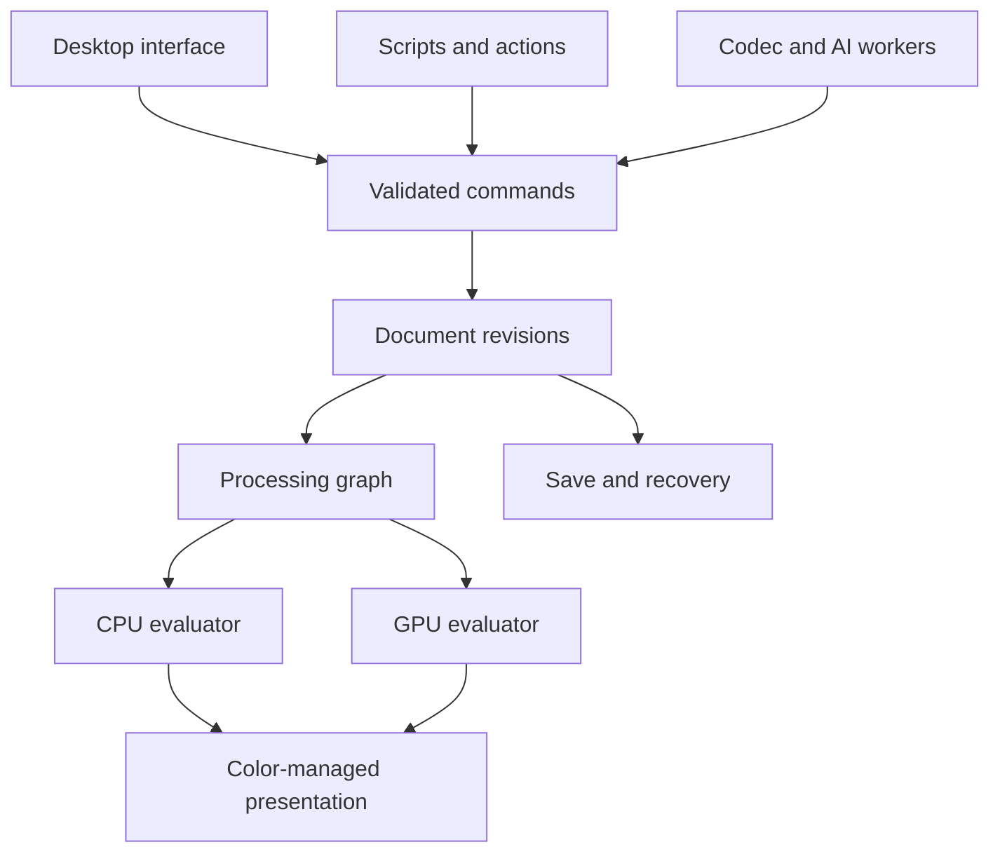

# ArchMage architecture overview

Status: S1-6. The headless core exists: vocabulary types, tiles, the document model, commands with an
executor and jobs, color profiles, the CPU evaluator and the brush; the interim window paints on a
document canvas (S1-3); documents save to and open from `.archmage` files (S1-4,
`docs/architecture/native-format.md`); a recovery journal, tile spooling and fault injection exist
headlessly (S1-5, `docs/architecture/recovery.md`); an opt-in Vulkan compute slice matches the CPU compositor
and the M0 probes have run (S1-6). The shell is planned design from
`docs/plans/Stage1_Development_Plan.md` and its ADRs in `docs/decisions/`. The "Contents" column lists
what exists today.

## Boundaries (spec §5.4)

Arrows show responsibility and data flow. Nothing mutates a document except a validated command
committed by the mutation executor (spec §9.1, ADR-0015). In Stage 1 the CPU evaluator is
authoritative and the GPU evaluator is an opt-in comparison (ADR-0012); there are no workers yet, and
the job model (S1-2.10) is the seam they will use (plan A-15).

## Module map

| Directory | Target | Namespace | Responsibility (spec §5.5) | Qt | Contents | Populated by |
| --- | --- | --- | --- | --- | --- | --- |
| `core/base/` | `archmage_base` | `archmage::base` | Vocabulary types (ADR-0102) | no | `Expected`, `Error` (ADR-0101), typed `Id`, `Geometry.h` (`IRect`, `DRect`), checked arithmetic, `secureRandomBytes`, `Sha256` | S1-2 |
| `core/document/` | `archmage_document` | `archmage::document` | Document graph, revisions, resource references, invariants | no | `Version.h`; `Document.h`: `DocumentState`, `Layer`, `RasterContent`, `Revision`, `validate()` | S1-2 |
| `core/commands/` | `archmage_commands` | `archmage::commands` | Operations, validation, transactions, undo descriptions | no | `CommandEnvelope`, `CommandDefinition`, `CommandRegistry`, `createDocument`, Stage 1 layer commands, `MutationExecutor`, `JobScheduler` | S1-2 |
| `core/tiles/` | `archmage_tiles` | `archmage::tiles` | Sparse tile storage, sharing, cache, storage-backed eviction | no | `SampleType`, `ChannelLayout`, `Tile` (pins, spooling), `TileBuffer`, `TileMap` (chunked copy-on-write), `DirtyRegion`, `ResourceCoordinator`, `TileSpool` | S1-2, S1-5 |
| `core/render/` | `archmage_render` | `archmage::render` | Evaluation graph, scheduler, CPU kernels, GPU backend contracts | no | `ViewTransform`; `GraphNode`, `LayerSourceNode`, `CompositeNode`, `GaussianBlurNode` (halo), `compileGraph`; source-over kernels; `CpuEvaluator` with `RenderRequest` | S1-1, S1-2, S1-6 |
| `core/render/gpu/` | `archmage_gpu` | `archmage::gpu` | Vulkan compute slice, opt-in comparison (ADR-0012); not in `archmage_core` | no | `GpuContext` (headless device, validation counting, VRAM budget, device loss), `GpuEvaluator` (source-over compute shader, CPU fallback) | S1-6 |
| `core/color/` | `archmage_color` | `archmage::color` | Profiles, conversions, view transforms, proofing | no | `ColorProfile` (Little CMS, pinned sRGB, `fromPrimaries`), `ColorPolicy`, `ColorPipeline`, `iccTransform` | S1-2, S1-6 |
| `core/brush/` | `archmage_brush` | `archmage::brush` | Input processing, brush engines, stroke replay and deltas | no | `Stroke.h`: `BrushSettings`, `StrokeResampler`, round dabs, `StrokeMask`, `paintLayer`, `StrokeSession` | S1-3 |
| `io/native/` | `archmage_native` | `archmage::native` | `.archmage` container, save transaction, recovery workspace | no | schema 0.1 (`schema/0001.sql`), `Database`/`Statement` (SQLite), `Blob` codec, `writeDocument`, `readDocument`, `validateFile`, `inspectFile`, `saveDocument`, migrations, `Platform` (statfs, fsync, rename); `Recovery.h` (`RecoverySession`, `DocumentJournal`, discovery), `FaultPoints.h` | S1-4, S1-5 |
| `io/formats/` | `archmage_formats` | `archmage::formats` | PNG and JPEG codecs behind adapters | no | none (INTERFACE) | S1-8 |
| `ui/` | `archmage_ui` | `archmage::ui` | Tools, panels, canvas interaction, accessibility, themes | yes | `MainWindow` (spec §2.2 shell: tabbed documents, nine menus, tool strip, options row, Color and Layers docks, status bar with durability; saves and opens on a thread pool; dialogs behind `ShellPrompts`), `Theme` (dark Fusion palette, violet accent, SVG icons), `ColorState`, `OptionsRow`; `document/` (`DocumentSession`: executor, file state, journal), `DocumentView` (the `ToolHost`; temporary hand); `tools/` (`Tool` lifecycle, ADR-0105; `BrushTool`, `HandTool`, `ZoomTool`, `EyedropperTool`); `panels/` (`LayersModel`, `LayersPanel`, `ColorPanel`); `canvas/` (`CanvasSurface` with raster, QRhiWidget and QVulkanWindow adapters, ADR-0011; `DocumentFrameSource`), `input/` (`InputMapper`), `experiments/` (S1-1 harness, brush latency benchmark) | S1-1, S1-3, S1-7, S1-8 |
| `apps/archmage/` | `archmage` | n/a | Desktop executable | yes | applies the theme and opens `MainWindow` with the files named on the command line; `--experiment=canvas:<kind>` runs the S1-1 harness; `--benchmark=brush-latency` (S1-3.7); `--benchmark=launch` (S1-6) | S1-7, S1-8 |
| `apps/archmage-cli/` | `archmage-cli` | n/a | Headless validate, inspect, render, recover | no | `--version`, `validate [--deep] [--json]`, `inspect [--json]`, `recover [--session --output] [--json]`; hidden `selftest-save` and `selftest-disk-full` for AT-013 and AT-014 | S1-4, S1-5, S1-8 |

Canvas presentation (ADR-0011): every surface presents a CPU-rendered frame through `CanvasSurface`;
`CanvasSurface::defaultKind()` is raster unless `ARCHMAGE_CANVAS` selects `vulkan` or `rhi`. Shaders
compile at build time: SPIR-V headers through `cmake/ArchMageShaders.cmake`, qsb packages through
`qt_add_shaders`. Only `ui/` links Qt's private Gui module, for QRhi.

Aggregates: `archmage_core` links the seven core modules and `archmage_io` links the two io modules
(ADR-0006). A module without sources is an INTERFACE target; `archmage_add_module()` makes it a
static library once it lists sources. Only `ui/` and `apps/archmage/` may link Qt (ADR-0007).

Other directories: `tests/` (CTest tiers, ADR-0005), `benchmarks/` (`bench_main` and the M0 probes
`psd_probe`, `raw_probe`, `text_probe`, S1-6; results in `benchmarks/results/`), `fuzz/` (built only by the
`fuzz` preset; `native_reader_fuzz`, S1-5.8), `resources/`
(original assets only), `packaging/` (stub until M9), `cmake/` (build modules), `scripts/` (gates and
generators), `docs/` (plans, decisions, ledger, status).

## Build-time version stamp

`core/document/include/archmage/document/Version.h.in` is rendered by `cmake/GenerateVersion.cmake`
into `build/<preset>/core/document/generated/include/archmage/document/Version.h`, at configure time
and again before every build. The header carries the project version from `CMakeLists.txt` and the
abbreviated git commit (with `-dirty` when tracked files differ). `archmage-cli --version` prints
`ArchMage <version> (<revision>)`.

## Thread model (ADR-0024, ADR-0014)

| Thread | Owns | Notes |
| --- | --- | --- |
| GUI thread | Qt widgets, input mapping, presentation | Observes immutable revisions only |
| `MutationExecutor` thread (one per document) | Command validation and commits | Serializes every mutation; `requestId` idempotency; observers run here after each change |
| `CpuEvaluator` workers (`std::jthread`, `max(2, hardware_concurrency − 2)`) | Tile evaluation | `std::stop_token` cancellation per render; output tile cache under one mutex |
| `JobScheduler` workers | Long-running jobs | Read an immutable source revision; commit through `executeIf` or keep a candidate (spec §9.3) |
| Shell job pool (`QThreadPool`, two threads) | Saves and opens started from the window | A save drains the document's executor, then writes the revision current at that moment; a document cannot close while it saves, and the window waits for the pool before it is destroyed |
| Recovery journal (one per session) | Writes committed revisions every 2 s while dirty | Never blocks the executor (it observes revisions); tracks durability per revision; spooled tiles read back through a separate connection |

Data flow: a command envelope reaches the executor, which applies its `CommandDefinition` to the current
immutable `DocumentState` and publishes a new `Revision`; undo moves the history cursor back to an earlier
revision. Renders compile the revision's state into a graph (`compileGraph`) and evaluate tiles on the
CPU evaluator, keyed by `TileMap::generation()` and node parameters.

## Where to look next

- Decisions: `docs/decisions/ADR-0001` to `ADR-0030`, one per plan decision D-01 to D-30; ADR-0101
  onward record decisions made during implementation.
- Native files and the save transaction: `docs/architecture/native-format.md`.
- Recovery, spooling and fault injection: `docs/architecture/recovery.md`.
- Dependencies: `docs/dependencies/manifest.yaml`.
- Current state and evidence: `docs/implementation-status.md`.
